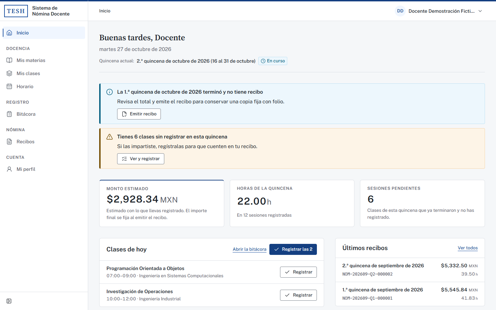
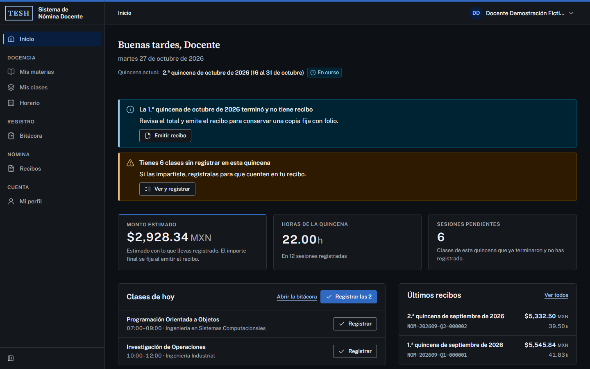
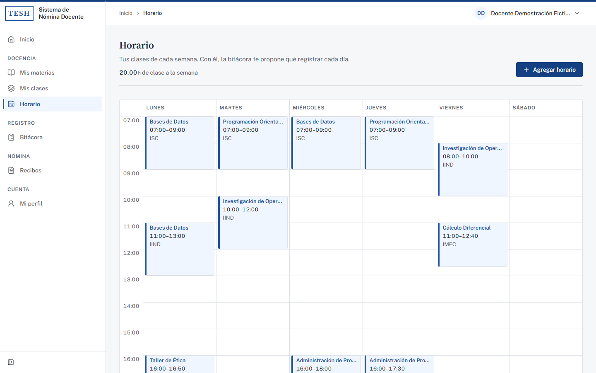
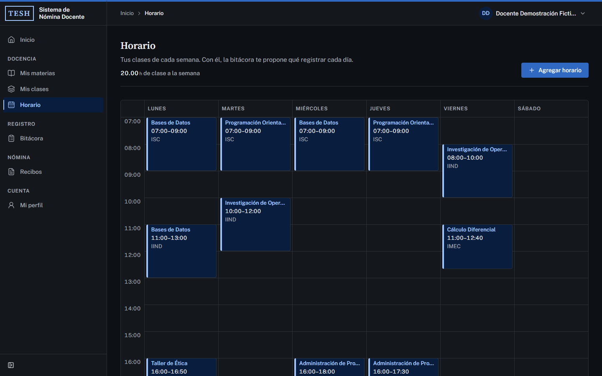
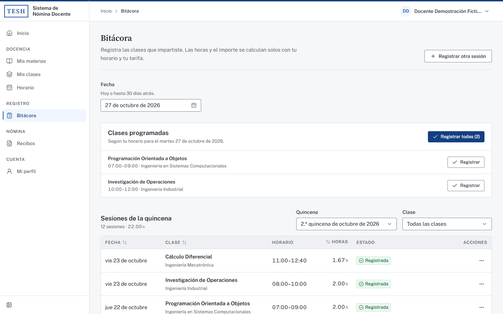
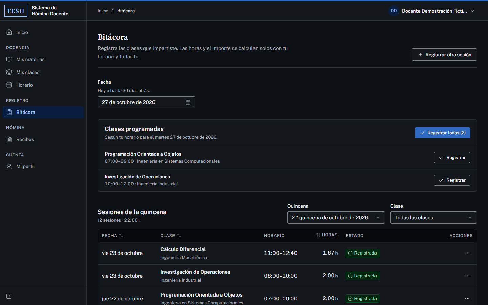
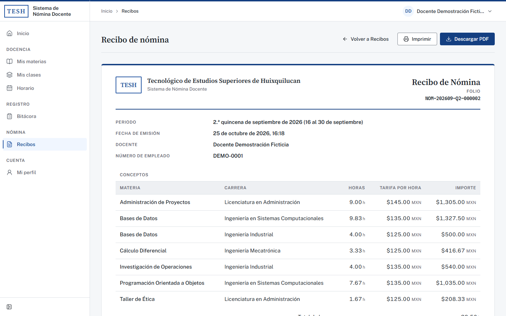
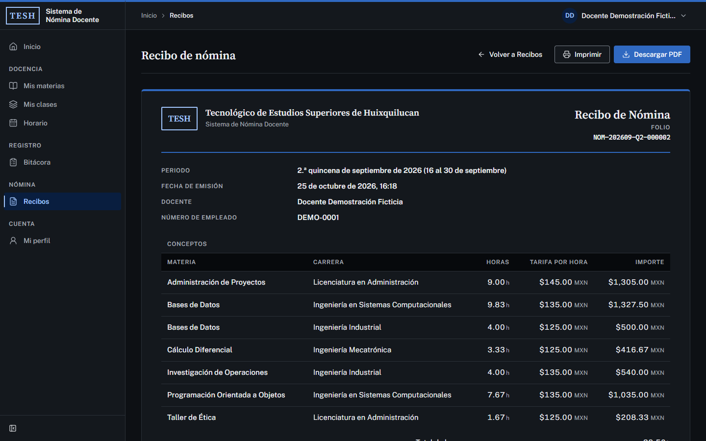
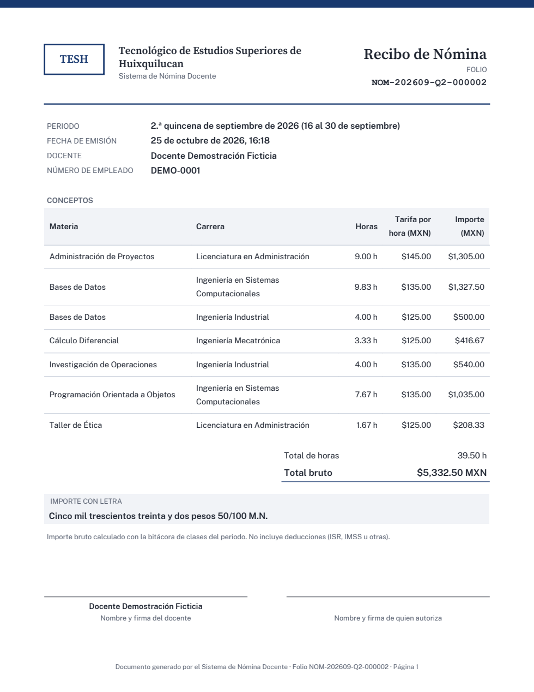

# Sistema de Nómina Docente

Aplicación web para que el personal docente del **Tecnológico de Estudios Superiores de Huixquilucan (TESH)** registre las clases que imparte y obtenga su **recibo de nómina quincenal**, calculado automáticamente y descargable en PDF.




## ¿Qué es y para quién?

Cada docente tiene su propia cuenta y solo ve su información. Registra una vez las materias que imparte, las asigna a una carrera con su tarifa por hora y arma su horario semanal. Cada día registra en la bitácora las clases que impartió (casi siempre con un clic) y, al cerrar la quincena, el sistema calcula las horas y el importe por materia y carrera y emite un recibo con folio que ya no cambia.

El sistema está pensado para **impedir errores**, no solo para reportarlos: todo lo que ya existe se elige de una lista, las horas usan formato de 24 h con máscara, no se aceptan fechas futuras ni horarios empalmados, los montos los calcula siempre el servidor con aritmética decimal exacta y toda acción irreversible pide confirmación explicando sus consecuencias.

## Funciones

| Sección          | Qué hace                                                                                                                                                                                                                                         |
| ---------------- | ------------------------------------------------------------------------------------------------------------------------------------------------------------------------------------------------------------------------------------------------ |
| **Inicio**       | Saludo, quincena actual, horas y monto estimado, clases de hoy para registrar en un clic, avisos con acción (clases sin registrar, quincena terminada sin recibo) y últimos recibos. Un docente nuevo ve una guía de configuración de tres pasos |
| **Mis materias** | Alta, edición y búsqueda sin acentos; una materia con historial se desactiva en lugar de borrarse                                                                                                                                                |
| **Mis clases**   | Materia + carrera + tarifa por hora, agrupadas por carrera, con sus horarios. Cambiar la tarifa no altera lo ya registrado                                                                                                                       |
| **Horario**      | Vista semanal en bloques (lista por día en celular). Si un horario choca con otro, el mensaje dice con qué clase, qué día y a qué hora                                                                                                           |
| **Bitácora**     | Clases programadas del día con horario precargado, registro fuera de horario con aviso, sesiones de la quincena con totales. Las quincenas con recibo quedan cerradas                                                                            |
| **Recibos**      | Vista previa por quincena con avisos, emisión con folio consecutivo, lista por año, detalle como documento oficial con importe con letra, impresión y **PDF tamaño carta**                                                                       |
| **Mi perfil**    | Datos personales, cambio de contraseña con requisitos en vivo y cierre de sesión en todos los dispositivos                                                                                                                                       |

Además: modo claro y oscuro, diseño adaptable a celular, accesibilidad WCAG 2.2 AA (contraste verificado por pruebas, navegación completa con teclado) y animaciones sutiles que respetan «reducir movimiento».

## Capturas

| Modo claro                                                     | Modo oscuro                                                      |
| -------------------------------------------------------------- | ---------------------------------------------------------------- |
|            |            |
|  |  |
|        |        |
|  |  |

<p align="center"></p>

## Instalación

Requisitos: **git**, **Python 3.12+** con [uv](https://docs.astral.sh/uv/), **Node.js 24 LTS** y **PostgreSQL 16+** (con `psql`). Funciona en Windows 11 con Git Bash y en Linux; todos los comandos se ejecutan desde la raíz del repositorio.

```bash
git clone https://github.com/Joryox/nomina-docente.git
cd nomina-docente
bash scripts/setup.sh              # crea backend/.env y frontend/.env.local e instala dependencias
```

Escribe la contraseña de tu usuario de PostgreSQL en `DB_PASSWORD` (`backend/.env`) y continúa:

```bash
bash scripts/create-databases.sh   # bases de desarrollo y de pruebas
bash scripts/migrate.sh            # tablas, restricciones y extensiones
bash scripts/seed.sh               # carreras del TESH, tarifas y roles
bash scripts/demo-data.sh          # cuenta de demostración (opcional)
bash scripts/dev.sh                # levanta todo: http://localhost:3000
```

`Ctrl+C` detiene ambos servidores. La documentación interactiva de la API está en http://127.0.0.1:8000/docs (solo fuera de producción). En Windows, configura los finales de línea del clon con `git config core.autocrlf false` y `git config core.eol lf`.

## Cuenta de demostración

`bash scripts/demo-data.sh` crea una docente **ficticia** con 6 materias, 7 clases en 4 carreras, horario semanal, bitácora de cuatro quincenas y dos recibos emitidos. La quincena anterior queda terminada y sin recibo, lista para probar la emisión.

| Correo                     | Contraseña            |
| -------------------------- | --------------------- |
| `docente.demo@example.com` | `Pizarron-Verde-2026` |

Solo se carga con `APP_ENV=development`.

## Estructura del proyecto

```
nomina-docente/
├── backend/                 API REST (FastAPI, arquitectura por capas)
│   ├── src/app/             código: routers → servicios → repositorios → modelos; dominio puro y PDF
│   ├── alembic/             migraciones del esquema (revisadas a mano)
│   └── tests/               pruebas unitarias y de integración (pytest)
├── frontend/                aplicación web (Next.js, organizada por funcionalidades)
│   ├── src/                 rutas, features, componentes del sistema de diseño, configuración
│   ├── e2e/                 pruebas de punta a punta (Playwright)
│   └── public/brand/        logos institucionales
├── docs/                    documentación técnica e imágenes
├── scripts/                 instalación, base de datos, datos de demostración y marca
├── CHANGELOG.md             historial de versiones
└── README.md
```

| Documento                                                | Contenido                                                                |
| -------------------------------------------------------- | ------------------------------------------------------------------------ |
| [`docs/arquitectura.md`](docs/arquitectura.md)           | Componentes, capas y flujo de datos                                      |
| [`docs/reglas-de-negocio.md`](docs/reglas-de-negocio.md) | Cada regla, dónde se valida y su prueba; fórmula del cálculo con ejemplo |
| [`docs/api.md`](docs/api.md)                             | Convenciones, endpoints y catálogo de códigos de error                   |
| [`docs/base-de-datos.md`](docs/base-de-datos.md)         | Modelo entidad-relación, diccionario de datos y migraciones              |
| [`docs/seguridad.md`](docs/seguridad.md)                 | Autenticación, sesiones, CSRF, CSP, amenazas y lista para producción     |
| [`docs/sistema-de-diseno.md`](docs/sistema-de-diseno.md) | Paleta, tipografía, tokens, componentes y accesibilidad                  |

## Logos y color institucional

Cuando lleguen los archivos oficiales, un solo comando los aplica en la interfaz y en el recibo en PDF:

```bash
bash scripts/apply-brand.sh <carpeta-con-logos> "#8A1538"
```

La carpeta debe tener `logo.svg` y, si existen, `logo-monochrome.svg` (modo oscuro) y `favicon.svg`. El script copia los archivos, declara los logos, genera la escala de color institucional a partir del código hexadecimal, actualiza el ícono de la pestaña y el PDF, y corre las pruebas de contraste. Detalle en [`docs/sistema-de-diseno.md`](docs/sistema-de-diseno.md#10-cómo-reemplazar-la-marca).

## Pruebas

```bash
# Backend (en backend/)
uv run ruff check . && uv run ruff format --check . && uv run mypy && uv run pytest

# Frontend (en frontend/)
npm run check && npm run build

# De punta a punta (con bash scripts/dev.sh en marcha, en frontend/)
npm run test:e2e
```

Las pruebas de punta a punta recorren el flujo completo de un docente nuevo, de la primera materia a la descarga del PDF, en escritorio y a 390 px de ancho.

## Tecnologías

| Capa          | Tecnologías                                                                                                                           |
| ------------- | ------------------------------------------------------------------------------------------------------------------------------------- |
| Backend       | Python 3.12+, FastAPI, Pydantic v2, SQLAlchemy 2, Alembic, psycopg 3, fpdf2, uv                                                       |
| Seguridad     | JWT revocable en cookie `HttpOnly`, refresh token rotativo, Argon2id, CSRF _double-submit_, CSP                                       |
| Frontend      | Next.js 16 (App Router), React 19, TypeScript estricto, Tailwind CSS 4, Radix UI, TanStack Query, React Hook Form, Zod, Framer Motion |
| Base de datos | PostgreSQL con restricciones de exclusión (`btree_gist`) y triggers de inmutabilidad                                                  |
| Calidad       | Ruff, mypy estricto, pytest, ESLint, Prettier, Vitest, Playwright                                                                     |

## Créditos

| Rol             | Nombre                                                    |
| --------------- | --------------------------------------------------------- |
| Desarrollo      | Jorge Raúl Ramos Alvarado                                 |
| Profesor asesor | Hugo Montes de Oca                                        |
| Institución     | Tecnológico de Estudios Superiores de Huixquilucan (TESH) |

Tipografías Public Sans y Source Serif 4 bajo licencia SIL Open Font License. Código bajo licencia [MIT](LICENSE).
