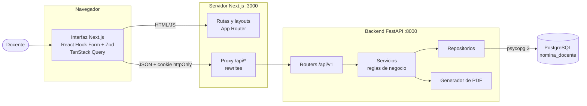
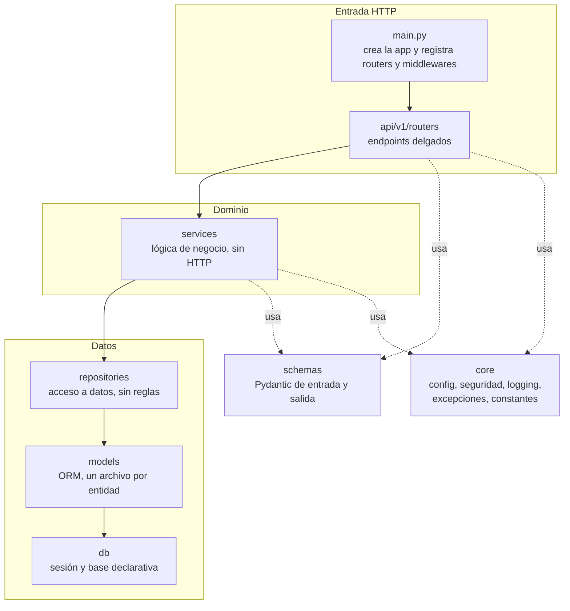
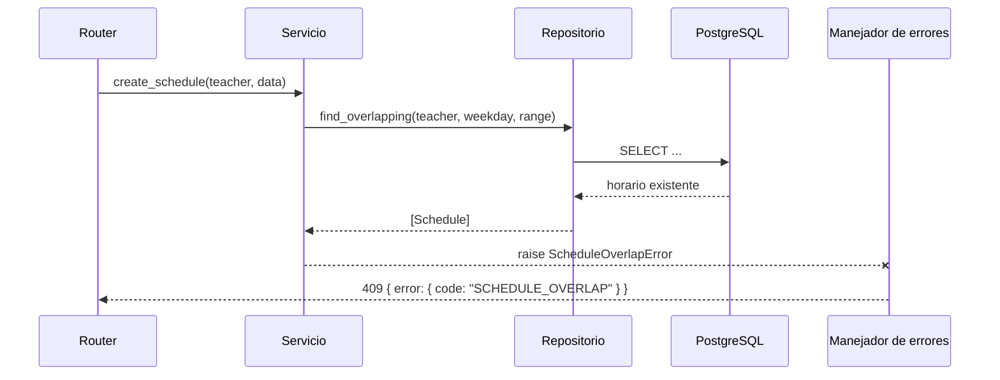
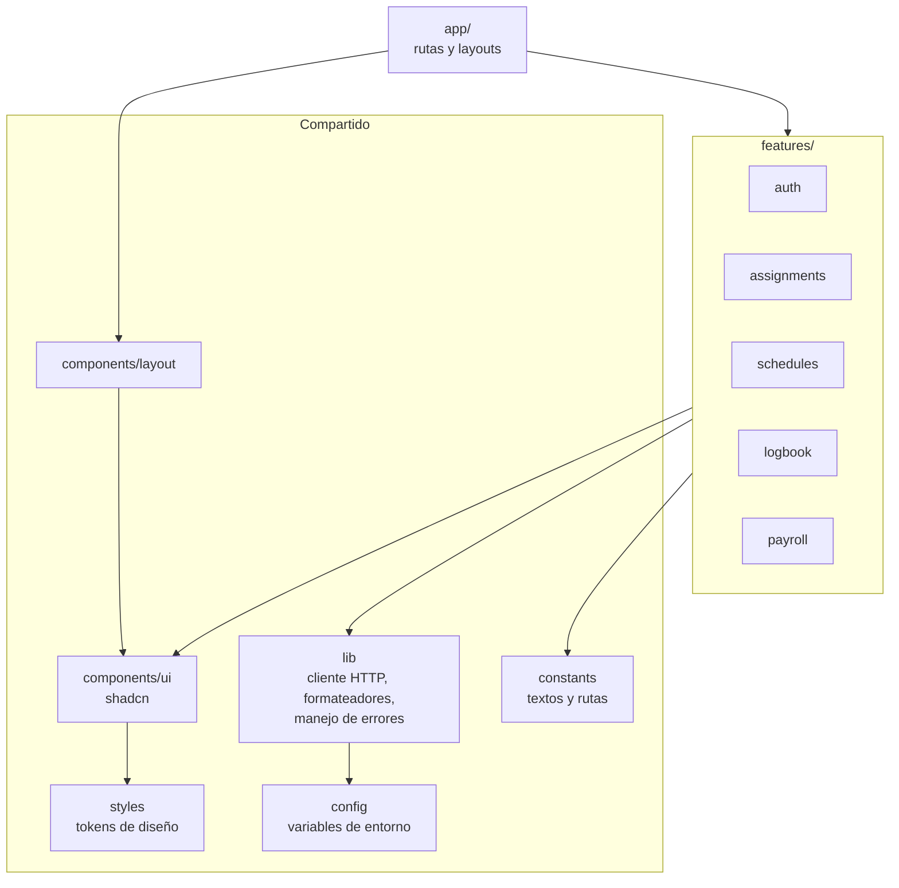
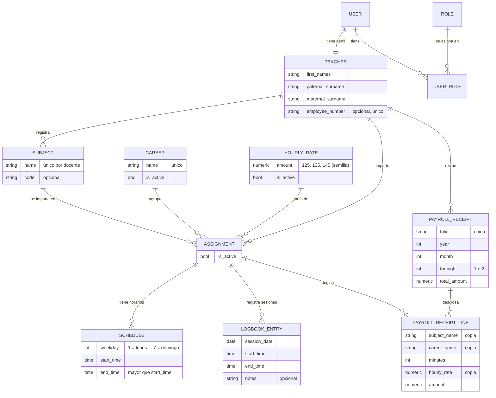
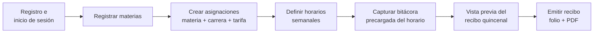

# Arquitectura del Sistema de Nómina Docente

Este documento describe el sistema a alto nivel: sus componentes, cómo se organizan las capas de cada aplicación y el modelo de datos conceptual. Las reglas de negocio completas y las convenciones están en [`CLAUDE.md`](../CLAUDE.md).

## 1. Visión general

El sistema permite a cada docente del TESH registrar las materias que imparte, sus horarios y las sesiones que realmente dio, y obtener a partir de ello su recibo de nómina quincenal, calculado automáticamente y descargable en PDF.

Se compone de tres piezas que se ejecutan en el equipo local:

| Componente | Tecnología | Responsabilidad |
| --- | --- | --- |
| Frontend | Next.js (App Router), TypeScript | Interfaz en es-MX, formularios con validación, presentación de datos |
| Backend | FastAPI, SQLAlchemy 2.0 | API REST, reglas de negocio, autenticación, cálculo de nómina, PDF |
| Base de datos | PostgreSQL | Persistencia y tercer nivel de validación mediante restricciones |

## 2. Diagrama de componentes



El navegador solo se comunica con el origen del frontend. Next.js reenvía las peticiones `/api/*` al backend, de modo que la cookie de sesión es de primera parte y no se requieren excepciones de CORS en el uso normal.

## 3. Capas y regla de dependencias

### 3.1 Backend

El backend sigue una arquitectura limpia por capas. Cada capa solo conoce a la que está inmediatamente debajo.



| Capa | Hace | No hace |
| --- | --- | --- |
| `api/v1/routers` | Recibe la petición, valida con `schemas`, obtiene al docente autenticado, llama al servicio y responde | Consultar la base de datos o aplicar reglas de negocio |
| `services` | Aplica las reglas de negocio (RN-XX), coordina repositorios, controla la transacción y lanza excepciones de dominio | Conocer `Request`, `Response` o códigos HTTP |
| `repositories` | Lee y escribe entidades, siempre filtradas por el docente dueño | Decidir si una operación es válida |
| `models` | Define tablas, relaciones y restricciones | Importar capas superiores |
| `schemas` | Define contratos de entrada y salida de la API | Depender de los modelos ORM |
| `core` | Configuración tipada, seguridad, logging, excepciones y constantes | Contener lógica de una funcionalidad concreta |

**Manejo de errores.** Los servicios lanzan excepciones de dominio (`NotFoundError`, `ConflictError`, `BusinessRuleError`, etc.). Un manejador central registrado en `main.py` las traduce a respuestas HTTP con un formato único:

```json
{ "error": { "code": "SCHEDULE_OVERLAP", "message": "…", "details": {} } }
```



### 3.2 Frontend

El frontend se organiza por funcionalidades. Las rutas de `app/` solo componen piezas; la lógica vive en `features/`.



Cada feature contiene `components/`, `hooks/`, `api/`, `schemas/` y `types/`. Una feature no importa archivos internos de otra; lo compartido se mueve a `components/`, `lib/` o `constants/`.

## 4. Modelo de datos conceptual



Puntos clave del modelo:

- **Identidad y perfil separados.** `USER` guarda credenciales; `TEACHER` guarda los datos del docente. Los roles se asignan por `USER_ROLE`, lo que permite agregar un administrador sin rehacer tablas.
- **Catálogos en base de datos.** Carreras y tarifas son catálogos con datos semilla; el frontend obtiene sus opciones de la API.
- **Recibo congelado.** Al emitirse, cada renglón copia materia, carrera, tarifa, minutos e importe. El recibo no cambia aunque los catálogos cambien después.
- **Validación en base de datos.** Restricciones `CHECK`, llaves foráneas y restricciones de exclusión (no empalme de horarios ni de sesiones) protegen los datos aunque falle una validación previa.

## 5. Flujo principal



## 6. Cálculo de la nómina

Para un periodo quincenal (1 al 15, o 16 al último día del mes):

1. Se obtienen las sesiones de bitácora del docente cuya fecha cae en el periodo.
2. Se agrupan por asignación y se suman sus minutos.
3. `importe = minutos × tarifa / 60`, redondeado a 2 decimales con `ROUND_HALF_UP`.
4. `total bruto = suma de importes`.

Todo el cálculo usa `Decimal` en Python y `NUMERIC` en PostgreSQL. No se calculan deducciones (ISR, IMSS) en esta versión.
