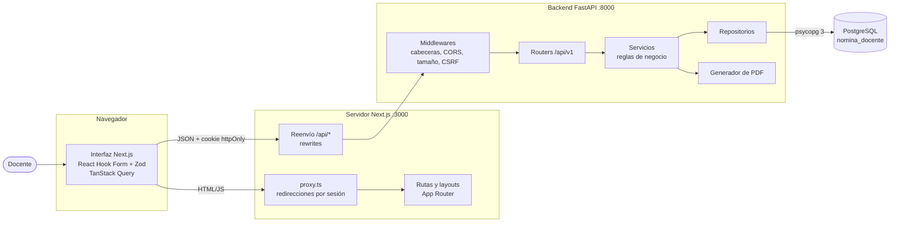
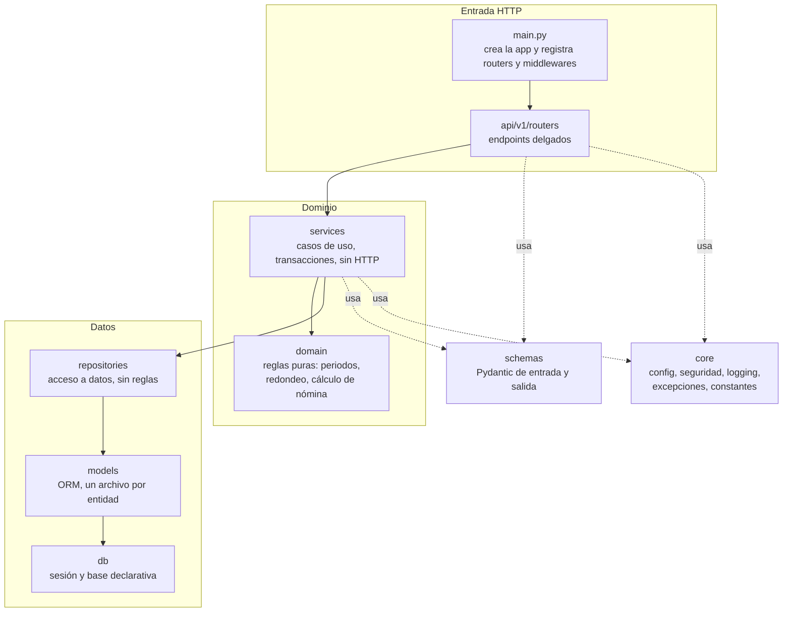
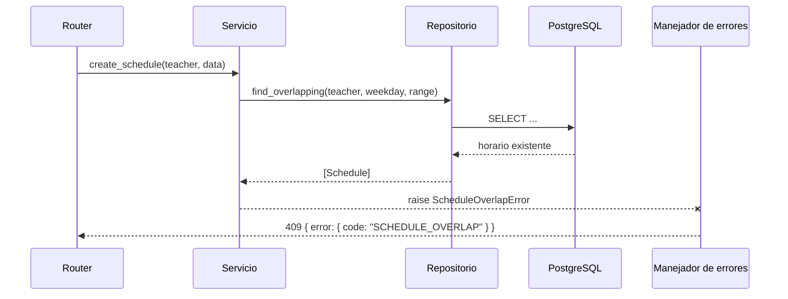
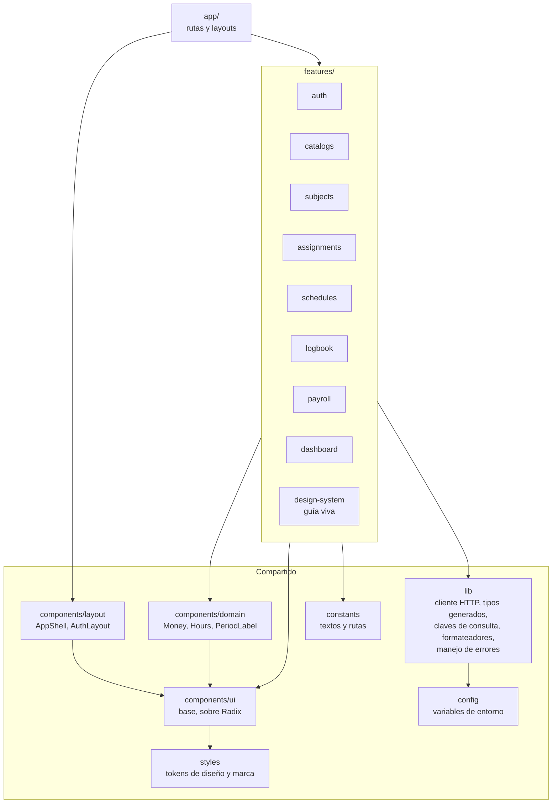
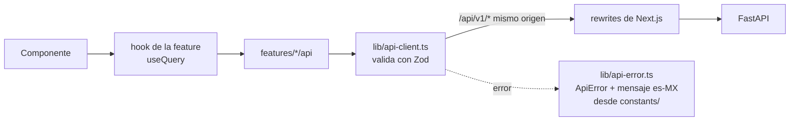
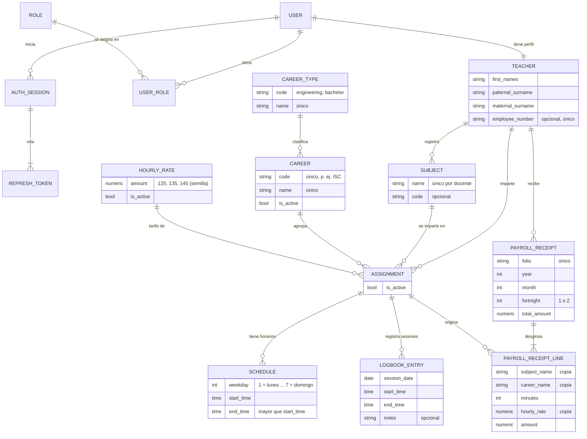
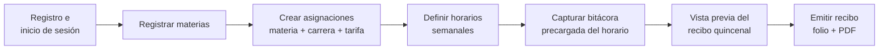

# Arquitectura del Sistema de Nómina Docente

Este documento describe el sistema a alto nivel: sus componentes, cómo se organizan las capas de cada aplicación y el modelo de datos conceptual. Las reglas de negocio completas y las convenciones están en [`CLAUDE.md`](../CLAUDE.md); el esquema de base de datos en [`base-de-datos.md`](base-de-datos.md); la seguridad (autenticación, sesiones, CSRF, amenazas) en [`seguridad.md`](seguridad.md); cada regla de negocio con dónde se valida y su prueba en [`reglas-de-negocio.md`](reglas-de-negocio.md), y los endpoints y códigos de error en [`api.md`](api.md).

## 1. Visión general

El sistema permite a cada docente del Tecnológico de Estudios Superiores de Huixquilucan (TESH) registrar las materias que imparte, sus horarios y las sesiones que realmente dio, y obtener a partir de ello su recibo de nómina quincenal, calculado automáticamente y descargable en PDF.

Se compone de tres piezas que se ejecutan en el equipo local:

| Componente | Tecnología | Responsabilidad |
| --- | --- | --- |
| Frontend | Next.js (App Router), TypeScript | Interfaz en es-MX, formularios con validación, presentación de datos |
| Backend | FastAPI, SQLAlchemy 2.0 | API REST, reglas de negocio, autenticación, cálculo de nómina, PDF |
| Base de datos | PostgreSQL | Persistencia y tercer nivel de validación mediante restricciones |

## 2. Diagrama de componentes



El navegador solo se comunica con el origen del frontend. Next.js reenvía las peticiones `NEXT_PUBLIC_API_BASE_PATH/*` (`/api/v1/*`) a `API_PROXY_TARGET` mediante `rewrites`, de modo que la cookie de sesión es de primera parte y no se requieren excepciones de CORS en el uso normal. Se eligieron `rewrites` y no un *route handler* propio porque reenvían de forma transparente las cabeceras `Cookie` y `Set-Cookie` y el encabezado CSRF, sin código adicional que mantener. El destino se calcula al iniciar `next dev` o al compilar con `next build`.

## 3. Capas y regla de dependencias

### 3.1 Backend

El backend sigue una arquitectura limpia por capas. Cada capa solo conoce a la que está inmediatamente debajo.



| Capa | Hace | No hace |
| --- | --- | --- |
| `api/v1/routers` | Recibe la petición, valida con `schemas`, obtiene al docente autenticado, llama al servicio y responde | Consultar la base de datos o aplicar reglas de negocio |
| `api/v1/dependencies.py` | Raíz de composición: construye cada servicio con sus repositorios y la sesión (`get_db`) y lo entrega a los routers mediante `Depends` | Contener lógica; es el único punto de la capa API que conoce sesiones y repositorios |
| `services` | Aplica las reglas de negocio (RN-XX), coordina repositorios, controla la transacción y lanza excepciones de dominio | Conocer `Request`, `Response` o códigos HTTP |
| `domain` | Reglas puras sin E/S: periodos quincenales, redondeo de dinero y horas (único módulo que redondea), cálculo del recibo, intervalos de clase, ocurrencias del horario. Solo importa `core.constants` | Acceder a la base, al reloj o a HTTP |
| `repositories` | Lee y escribe entidades, siempre filtradas por el docente dueño | Decidir si una operación es válida |
| `models` | Define tablas, relaciones y restricciones | Importar capas superiores |
| `schemas` | Define contratos de entrada y salida de la API | Depender de los modelos ORM |
| `core` | Configuración tipada, seguridad, logging, middleware de peticiones, excepciones y constantes | Contener lógica de una funcionalidad concreta |

**Arranque.** `main.create_app()` (patrón *app factory*) lee la configuración, configura el logging JSON y registra los middlewares (de afuera hacia adentro): contexto de petición (`X-Request-ID` y registro de cada petición), cabeceras de seguridad, CORS con la lista blanca de `CORS_ORIGINS`, límite de tamaño del cuerpo y CSRF *double-submit*; después, los manejadores de errores y el router de `/api/v1`. En producción no publica la documentación OpenAPI. `python -m app` levanta Uvicorn con el host y el puerto de la configuración. Si falta una variable de entorno, `get_settings()` lanza `ConfigurationError` con la lista de variables con problema y la app no inicia.

**Autenticación y acceso.** `api/v1/dependencies.py` ofrece `get_current_user`, `get_current_teacher` y `require_roles(...)`: toda ruta de negocio los declara y pasa el docente autenticado al servicio, que filtra por él (RN-04). La validación del JWT, la rotación de sesiones y la revocación viven en `services/sessions.py`; el registro e inicio de sesión en `services/auth.py`; el perfil y el cambio de contraseña en `services/account.py`. El servicio controla la transacción con `repositories/unit_of_work.py`. Las piezas sin estado (Argon2, JWT, política de contraseñas, middlewares, auditoría) están en `core/security/`. Detalle y diagramas en [`seguridad.md`](seguridad.md).

**Lógica de negocio (etapa 4).** Cada funcionalidad tiene su servicio (`subjects`, `assignments`, `schedules`, `logbook`, `payroll`, `dashboard`, `catalogs`). La vista previa y la emisión del recibo llaman a la misma función pura `domain.payroll.calculate_payroll`, así que sus totales coinciden. La fecha del negocio la da un `BusinessCalendar` inyectable (zona `America/Mexico_City`), separado del reloj de sesión para que las pruebas fijen «hoy» sin invalidar los tokens. Los límites configurables (duración de clases, antigüedad de la bitácora, regla de emisión) llegan a los servicios como `BusinessPolicy`. Las escrituras de bitácora y la emisión bloquean la fila del docente (`FOR NO KEY UPDATE`) para que no compitan entre sí. Detalle en [`reglas-de-negocio.md`](reglas-de-negocio.md).

**Manejo de errores.** Los servicios lanzan excepciones de dominio (`NotFoundError`, `ConflictError`, `BusinessRuleError`, etc.); `domain_error(code)` elige la clase según el estado HTTP que el catálogo `ERROR_CATALOG` asigna a cada código. Si la base rechaza una escritura, `services/constraints.py` traduce el nombre de la restricción al mismo código. Un manejador central registrado en `main.py` las traduce a respuestas HTTP con un formato único:

```json
{ "error": { "code": "SCHEDULE_OVERLAP", "message": "…", "details": {} } }
```



### 3.2 Frontend

El frontend se organiza por funcionalidades. Las rutas de `app/` solo componen piezas; la lógica vive en `features/`.



Cada feature contiene `components/`, `hooks/`, `api/`, `schemas/` y `types/`. Su superficie pública son `components/` y `hooks/`: otra feature puede usarlos (el inicio del panel usa el botón de registro rápido de `logbook` y el de emisión de `payroll`; el diálogo de asignación usa los hooks de `subjects` y `catalogs`). Nunca importa su `api/`, `schemas/` ni `types/`, y lo que compartan varias se mueve a `components/`, `lib/` o `constants/`. Desde la etapa 6 la raíz `/` solo redirige (al panel o a iniciar sesión) y la página temporal de estado del sistema ya no existe; `GET /api/v1/health` sigue disponible para diagnóstico.

**Sistema de diseño (etapa 5).** `styles/` es la única fuente de valores visuales: `brand.css` (color institucional), `tokens.css` (primitivos y semánticos en OKLCH para modo claro y oscuro, tipografía, espaciado, formas, sombras, capas y movimiento) y `globals.css` (mapeo a Tailwind; las escalas por defecto se eliminan para que solo existan utilidades semánticas). `components/ui/` tiene los componentes base sobre Radix, `components/domain/` los que conocen el dominio (`Money`, `Hours`, `PeriodLabel`, `Folio`, `StatusBadge`) y `components/layout/` la estructura (`AppShell`, `AuthLayout`, `PageHeader`, `Logo`). Los componentes de `components/` no importan features: `features/auth/components/authenticated-shell.tsx` es quien conecta el `AppShell` con la sesión. El tema se aplica antes de pintar con un script en `<head>` (`lib/theme/`). La identidad se configura en `config/brand.ts` y las fuentes en `config/fonts.ts`. Detalle, reglas de uso y verificaciones en [`sistema-de-diseno.md`](sistema-de-diseno.md).

**Rutas y sesión.** Las rutas están en español y centralizadas en `constants/routes.ts`: `/iniciar-sesion`, `/registro` y `/panel` (provisional hasta la etapa 6). `src/proxy.ts` (en Next.js 16, `middleware` se llama `proxy`) redirige a `/iniciar-sesion?siguiente=…` si no hay sesión y al panel si ya la hay, mirando solo una cookie indicadora; la autorización real la hace la API. La feature `auth` contiene las llamadas tipadas, los esquemas de Zod (construidos con la política de contraseñas que publica el backend), los hooks (`useSession`, `useLogin`, `useRegister`, `useLogout`, `usePasswordPolicy`) y los formularios.

**Acceso a la API y errores.** El flujo de una consulta es siempre el mismo:



- `api-client.ts` es el único módulo que usa `fetch` (lo garantiza una regla de ESLint). Envía `X-CSRF-Token` en los métodos que modifican datos (y pide el token si aún no existe), valida cada respuesta con un schema de Zod y convierte cualquier falla en `ApiError`. Ante un 401 renueva la sesión **una sola vez**, compartida entre las peticiones simultáneas, y repite la petición; si no puede, avisa para llevar a iniciar sesión.
- `api-error.ts` interpreta el formato único de error del backend. Si el backend no responde (el proxy devuelve 5xx sin JSON), usa el código local `BACKEND_UNAVAILABLE`. `toUserMessage()` es el único punto que traduce errores a textos en español.
- Las variables de entorno se validan con Zod en `config/`. `next.config.ts` reutiliza esa validación para construir el proxy.
- **Tipos generados.** `lib/api-types.gen.ts` se genera desde el OpenAPI del backend con `npm run api:types` (`scripts/generate-api-types.sh`; `npm run api:check` falla si está desactualizado). Cada schema de Zod se declara con `satisfies z.ZodType<…>` contra el tipo generado, y los textos de error y de advertencia son `Record` sobre los códigos generados: si el backend cambia un contrato o agrega un código, TypeScript lo señala.
- **Datos del servidor.** Las claves de TanStack Query viven en `lib/query-keys.ts` y `lib/query-invalidation.ts` define qué consultas se invalidan con cada tipo de cambio (por ejemplo, registrar una sesión invalida la bitácora, la vista previa, el panel y las asignaciones). Lo que comparten varias features (schemas de carrera, tarifa, horario, periodo, recibo) vive en `lib/api-schemas.ts`.
- **Formatos.** `lib/formatters.ts` formatea dinero, horas, fechas y periodos a partir de las cadenas decimales de la API, sin convertirlas a número.

## 4. Modelo de datos conceptual

Vista resumida. El esquema completo, con el diccionario de datos y las decisiones de diseño, está en [`base-de-datos.md`](base-de-datos.md).



Puntos clave del modelo:

- **Identidad y perfil separados.** `USER` guarda credenciales; `TEACHER` guarda los datos del docente. Los roles se asignan por `USER_ROLE`, lo que permite agregar un administrador sin rehacer tablas.
- **Catálogos en base de datos.** Carreras (con su tipo: ingeniería o licenciatura), tarifas y roles son catálogos con datos semilla; el frontend obtiene sus opciones de la API. Las 7 carreras salen del volante oficial de admisión 2024 del TESH.
- **Recibo congelado.** Al emitirse, cada renglón copia materia, carrera, tarifa, minutos e importe, y el encabezado copia los datos del docente. Triggers de la base impiden modificar o borrar el recibo y cierran la bitácora del periodo.
- **Identificadores.** Llave primaria `bigint` identity en todas las tablas; las entidades del docente que expone la API tienen además un `public_id` UUID para no revelar identificadores secuenciales.
- **Validación en base de datos.** Restricciones `CHECK`, llaves foráneas (algunas compuestas, para que los datos de un docente nunca se mezclen con los de otro) y restricciones de exclusión con `btree_gist` (no empalme de horarios ni de sesiones) protegen los datos aunque falle una validación previa.

## 5. Flujo principal



## 6. Cálculo de la nómina

Para un periodo quincenal (1 al 15, o 16 al último día del mes):

1. Se obtienen las sesiones de bitácora del docente cuya fecha cae en el periodo.
2. Se agrupan por asignación **y tarifa** (cada sesión guarda la tarifa vigente al registrarla) y se suman sus minutos.
3. `importe = minutos × tarifa / 60`, redondeado a 2 decimales con `ROUND_HALF_UP`.
4. `total bruto = suma de importes`.

Todo el cálculo usa `Decimal` en Python y `NUMERIC` en PostgreSQL, y vive en `backend/src/app/domain/` (`money.py` es el único módulo que redondea). No se calculan deducciones (ISR, IMSS) en esta versión. Fórmula con un ejemplo numérico completo y diagramas de la emisión en [`reglas-de-negocio.md`](reglas-de-negocio.md).

## 7. Datos de demostración

`scripts/demo-data.sh` (`python -m app.demo`) carga, solo con `APP_ENV=development`, una cuenta ficticia con materias, asignaciones, horarios, bitácora de varias quincenas y recibos emitidos. No escribe en las tablas de negocio directamente: usa los mismos servicios que la API, con un calendario que «viaja» a la fecha de cada sesión, así que los datos cumplen todas las reglas. Es idempotente.
