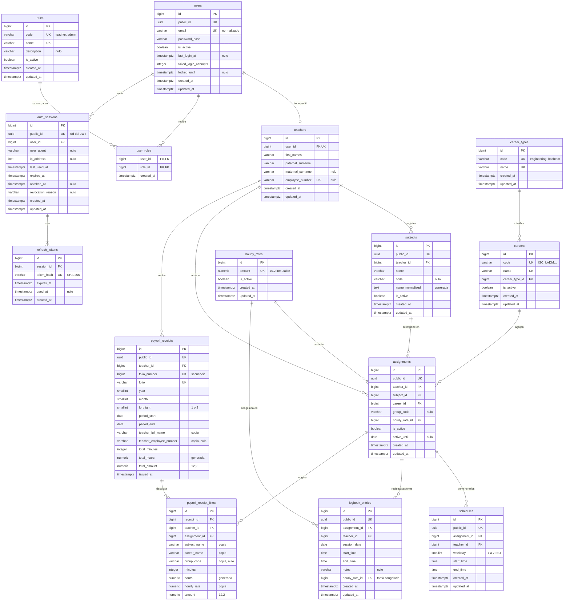

# Base de datos del Sistema de Nómina Docente

Este documento describe el esquema de PostgreSQL del sistema: el modelo entidad-relación, el diccionario de datos, las decisiones de diseño y la forma de operar migraciones y datos semilla. Las reglas de negocio citadas (`RN-XX`) están en [`reglas-de-negocio.md`](reglas-de-negocio.md) y la arquitectura general en [`arquitectura.md`](arquitectura.md).

| Concepto | Valor |
| --- | --- |
| Motor | PostgreSQL 16 o superior (desarrollo con 18.3) |
| Bases | `nomina_docente` (desarrollo) y `nomina_docente_test` (pruebas automatizadas) |
| Codificación | UTF-8 (`TEMPLATE template0`) |
| Fuente de verdad del esquema | Migraciones de Alembic en [`backend/alembic/versions/`](../backend/alembic/versions/): esquema inicial (`3295e857da8d`), sesiones y bloqueo de acceso (`067cd1ed562c`) y lógica de negocio (`8c41d2f7a9b3`) |
| Modelos ORM | [`backend/src/app/models/`](../backend/src/app/models/), un archivo por tabla |
| Datos semilla | [`backend/src/app/seeds/data/`](../backend/src/app/seeds/data/) |

---

## 1. Diagrama entidad-relación

Cardinalidades en notación *crow's foot*: `||` exactamente uno, `o|` cero o uno, `o{` cero o muchos, `|{` uno o muchos. Las columnas marcadas `FK` que forman parte de una llave compuesta se explican en la sección 3.3.



## 2. Diccionario de datos

Convenciones de las tablas:

- **Tipo**: tipo de PostgreSQL. `varchar(n)` es `character varying(n)`; `timestamptz` es `timestamp with time zone`.
- **Nulo**: `No` significa `NOT NULL`.
- **Recortado**: el `CHECK` `<columna>_trimmed` exige que el texto no esté vacío y no tenga espacios al inicio ni al final (`col = btrim(col) AND col <> ''`). En columnas opcionales, `NULL` se permite y la cadena vacía no.
- Todas las tablas con `updated_at` tienen el trigger `trg_<tabla>_set_updated_at`, que lo actualiza en cada `UPDATE` (sección 3.6).

### 2.1 `users` — cuentas de acceso

Identidad y credenciales. El perfil del docente vive aparte, en `teachers`.

| Columna | Tipo | Nulo | Restricciones | Descripción |
| --- | --- | --- | --- | --- |
| `id` | `bigint` | No | PK, `GENERATED ALWAYS AS IDENTITY` | Identificador interno |
| `public_id` | `uuid` | No | Único, por defecto `gen_random_uuid()` | Identificador que expone la API (y el `sub` del JWT) |
| `email` | `varchar(254)` | No | Único; `ck_users_email_normalized` (`email = lower(btrim(email))`); `ck_users_email_format` (un `@`, sin espacios) | Correo, guardado en minúsculas y sin espacios (RN-02) |
| `password_hash` | `varchar(255)` | No | | Hash Argon2id; la contraseña nunca se guarda |
| `is_active` | `boolean` | No | Por defecto `true` | Permite suspender la cuenta sin borrarla |
| `last_login_at` | `timestamptz` | Sí | | Último inicio de sesión exitoso (el registro cuenta como el primero) |
| `failed_login_attempts` | `integer` | No | Por defecto `0`; `ck_users_failed_login_attempts_non_negative` (`>= 0`) | Intentos fallidos seguidos; vuelve a `0` al entrar o al bloquearse |
| `locked_until` | `timestamptz` | Sí | | Fin del bloqueo temporal por fuerza bruta (`LOGIN_LOCKOUT_MINUTES`) |
| `created_at` | `timestamptz` | No | Por defecto `now()` | Alta del registro |
| `updated_at` | `timestamptz` | No | Por defecto `now()`, trigger | Última modificación |

### 2.2 `roles` — catálogo de roles

| Columna | Tipo | Nulo | Restricciones | Descripción |
| --- | --- | --- | --- | --- |
| `id` | `bigint` | No | PK, identity | Identificador interno |
| `code` | `varchar(20)` | No | Único; `ck_roles_code_format` (`^[a-z][a-z_]*$`) | Código estable que conoce el código (`teacher`, `admin`) |
| `name` | `varchar(150)` | No | Único, recortado | Nombre visible (`Docente`) |
| `description` | `varchar(255)` | Sí | | Qué permite el rol |
| `is_active` | `boolean` | No | Por defecto `true` | `admin` está cargado pero inactivo: reservado para una versión futura |
| `created_at`, `updated_at` | `timestamptz` | No | | Marcas de tiempo |

### 2.3 `user_roles` — roles otorgados (N:M)

| Columna | Tipo | Nulo | Restricciones | Descripción |
| --- | --- | --- | --- | --- |
| `user_id` | `bigint` | No | PK compuesta; FK → `users.id` `ON DELETE CASCADE` | Usuario |
| `role_id` | `bigint` | No | PK compuesta; FK → `roles.id` `ON DELETE RESTRICT`; índice | Rol otorgado |
| `created_at` | `timestamptz` | No | Por defecto `now()` | Cuándo se otorgó el rol |

### 2.4 `teachers` — perfil del docente (1:1 con `users`)

| Columna | Tipo | Nulo | Restricciones | Descripción |
| --- | --- | --- | --- | --- |
| `id` | `bigint` | No | PK, identity | Identificador interno; lo referencian todas las tablas del docente |
| `user_id` | `bigint` | No | Único; FK → `users.id` `ON DELETE RESTRICT` | Cuenta del docente (relación 1:1) |
| `first_names` | `varchar(100)` | No | Recortado | Nombre(s) |
| `paternal_surname` | `varchar(100)` | No | Recortado | Apellido paterno |
| `maternal_surname` | `varchar(100)` | Sí | Recortado | Apellido materno; opcional porque hay personas con un solo apellido |
| `employee_number` | `varchar(20)` | Sí | Único (admite varios `NULL`), recortado | Número de empleado opcional (RN-03) |
| `created_at`, `updated_at` | `timestamptz` | No | | Marcas de tiempo |

### 2.5 `career_types` — catálogo de tipos de carrera

| Columna | Tipo | Nulo | Restricciones | Descripción |
| --- | --- | --- | --- | --- |
| `id` | `bigint` | No | PK, identity | Identificador interno |
| `code` | `varchar(20)` | No | Único; `^[a-z][a-z_]*$` | `engineering`, `bachelor` |
| `name` | `varchar(150)` | No | Único, recortado | `Ingeniería`, `Licenciatura` |
| `created_at`, `updated_at` | `timestamptz` | No | | Marcas de tiempo |

### 2.6 `careers` — catálogo de carreras

Fuente del catálogo: volante oficial de admisión 2024 del TESH (sección 5.1).

| Columna | Tipo | Nulo | Restricciones | Descripción |
| --- | --- | --- | --- | --- |
| `id` | `bigint` | No | PK, identity | Identificador interno |
| `code` | `varchar(20)` | No | Único; `ck_careers_code_format` (`^[A-Z][A-Z0-9]*$`) | Clave corta (`ISC`, `LADM`) |
| `name` | `varchar(150)` | No | Único, recortado | Nombre oficial |
| `career_type_id` | `bigint` | No | FK → `career_types.id` `ON DELETE RESTRICT`; índice | Tipo de programa |
| `is_active` | `boolean` | No | Por defecto `true` | Baja lógica (RN-07): inactiva no aparece en selectores, pero conserva el historial |
| `created_at`, `updated_at` | `timestamptz` | No | | Marcas de tiempo |

### 2.7 `hourly_rates` — catálogo de tarifas por hora

| Columna | Tipo | Nulo | Restricciones | Descripción |
| --- | --- | --- | --- | --- |
| `id` | `bigint` | No | PK, identity | Identificador interno |
| `amount` | `numeric(10,2)` | No | Único; `ck_hourly_rates_amount_positive` (`> 0`); inmutable por el trigger `trg_hourly_rates_amount_immutable` | Tarifa en MXN por hora (RN-10, RN-12) |
| `is_active` | `boolean` | No | Por defecto `true` | Una tarifa retirada se desactiva; nunca se edita ni se borra |
| `created_at`, `updated_at` | `timestamptz` | No | | Marcas de tiempo |

### 2.8 `subjects` — materias del docente

| Columna | Tipo | Nulo | Restricciones | Descripción |
| --- | --- | --- | --- | --- |
| `id` | `bigint` | No | PK, identity; único `(id, teacher_id)` | Identificador interno |
| `public_id` | `uuid` | No | Único | Identificador para la API |
| `teacher_id` | `bigint` | No | FK → `teachers.id` `ON DELETE RESTRICT` | Docente dueño (RN-04, RN-08) |
| `name` | `varchar(150)` | No | Recortado | Nombre tal como lo escribió el docente |
| `code` | `varchar(20)` | Sí | Recortado | Clave opcional de la materia |
| `name_normalized` | `text` | No | Columna generada `normalize_name(name)`; único `(teacher_id, name_normalized)` | Nombre sin acentos, en minúsculas y con espacios simples (RN-09) |
| `is_active` | `boolean` | No | Por defecto `true` | Baja lógica: una materia usada en asignaciones no se borra, se desactiva (RN-32) |
| `created_at`, `updated_at` | `timestamptz` | No | | Marcas de tiempo |

### 2.9 `assignments` — asignaciones

Docente + materia + carrera + tarifa por hora (RN-13), con un grupo opcional (RN-41).

| Columna | Tipo | Nulo | Restricciones | Descripción |
| --- | --- | --- | --- | --- |
| `id` | `bigint` | No | PK, identity; único `(id, teacher_id)` | Identificador interno |
| `public_id` | `uuid` | No | Único | Identificador para la API |
| `teacher_id` | `bigint` | No | FK → `teachers.id` `RESTRICT`; índice | Docente |
| `subject_id` | `bigint` | No | FK compuesta `(subject_id, teacher_id)` → `subjects(id, teacher_id)` `RESTRICT`; índice | Materia, que debe ser del mismo docente |
| `career_id` | `bigint` | No | FK → `careers.id` `RESTRICT`; índice | Carrera del catálogo |
| `group_code` | `varchar(10)` | Sí | `ck_assignments_group_code_format`: `^[A-Z0-9]+(-[A-Z0-9]+)*$` | Grupo ya normalizado (`3101`, `3101-A`); nulo si no tiene (RN-41) |
| `hourly_rate_id` | `bigint` | No | FK → `hourly_rates.id` `RESTRICT`; índice | Tarifa del catálogo (RN-11) |
| `is_active` | `boolean` | No | Por defecto `true`; índice único parcial `uq_assignments_active_teacher_subject_career_group` sobre `(teacher_id, subject_id, career_id, group_code) NULLS NOT DISTINCT WHERE is_active` | Una sola asignación activa por materia, carrera y grupo; «sin grupo» cuenta como un valor (RN-14, RN-41) |
| `active_until` | `date` | Sí | `ck_assignments_active_until_consistent` (`is_active = (active_until IS NULL)`) | Último día activo (zona de la institución). Se aceptan sesiones con fecha hasta ese día (RN-38) |
| `created_at`, `updated_at` | `timestamptz` | No | | Marcas de tiempo |

### 2.10 `schedules` — horario semanal

| Columna | Tipo | Nulo | Restricciones | Descripción |
| --- | --- | --- | --- | --- |
| `id` | `bigint` | No | PK, identity | Identificador interno |
| `public_id` | `uuid` | No | Único | Identificador para la API |
| `assignment_id` | `bigint` | No | FK compuesta `(assignment_id, teacher_id)` → `assignments(id, teacher_id)` `ON DELETE CASCADE`; índice | Asignación del horario |
| `teacher_id` | `bigint` | No | Parte de la FK compuesta | Copia del docente de la asignación, necesaria para el no empalme |
| `weekday` | `smallint` | No | `ck_schedules_weekday_iso` (`BETWEEN 1 AND 7`) | Día ISO 8601: 1 = lunes … 7 = domingo (RN-16) |
| `start_time` | `time` | No | Sin segundos | Hora de entrada |
| `end_time` | `time` | No | `ck_schedules_end_after_start` (`end_time > start_time`); sin segundos | Hora de salida (RN-17) |
| `created_at`, `updated_at` | `timestamptz` | No | | Marcas de tiempo |

Restricción de exclusión `ex_schedules_no_overlap`: `EXCLUDE USING gist (teacher_id WITH =, weekday WITH =, timerange(start_time, end_time, '[)') WITH &&)` (RN-18).

### 2.11 `logbook_entries` — bitácora de sesiones impartidas

| Columna | Tipo | Nulo | Restricciones | Descripción |
| --- | --- | --- | --- | --- |
| `id` | `bigint` | No | PK, identity | Identificador interno |
| `public_id` | `uuid` | No | Único | Identificador para la API |
| `assignment_id` | `bigint` | No | FK compuesta `(assignment_id, teacher_id)` → `assignments(id, teacher_id)` `ON DELETE RESTRICT`; índice | Asignación impartida (RN-19) |
| `teacher_id` | `bigint` | No | Parte de la FK compuesta; índice `(teacher_id, session_date)` | Copia del docente, para el no empalme y la consulta por periodo |
| `session_date` | `date` | No | | Fecha de la sesión (zona `America/Mexico_City`) |
| `start_time` | `time` | No | Sin segundos | Hora de entrada |
| `end_time` | `time` | No | `end_time > start_time`; sin segundos | Hora de salida |
| `notes` | `varchar(500)` | Sí | Recortado | Observaciones opcionales |
| `hourly_rate_id` | `bigint` | No | FK → `hourly_rates.id` `RESTRICT`; índice | Tarifa vigente de la asignación cuando se registró la sesión (RN-33, sección 3.9) |
| `created_at`, `updated_at` | `timestamptz` | No | | Marcas de tiempo |

Restricción de exclusión `ex_logbook_entries_no_overlap`: `EXCLUDE USING gist (teacher_id WITH =, session_date WITH =, timerange(start_time, end_time, '[)') WITH &&)` (RN-22). Trigger `trg_logbook_entries_period_locked`: impide insertar, editar o borrar sesiones de un periodo con recibo emitido (RN-23).

### 2.12 `payroll_receipts` — recibos emitidos

Copia fija e inmutable de la nómina de un periodo (RN-28).

| Columna | Tipo | Nulo | Restricciones | Descripción |
| --- | --- | --- | --- | --- |
| `id` | `bigint` | No | PK, identity; único `(id, teacher_id)` | Identificador interno |
| `public_id` | `uuid` | No | Único | Identificador para la API |
| `teacher_id` | `bigint` | No | FK → `teachers.id` `RESTRICT` | Docente |
| `folio_number` | `bigint` | No | Único; por defecto `nextval('payroll_receipts_folio_number_seq')`; `> 0` | Consecutivo del folio, generado por la base (RN-30) |
| `folio` | `varchar(40)` | No | Único, recortado | Folio completo, p. ej. `NOM-202610-Q2-000042` |
| `year` | `smallint` | No | | Año del periodo |
| `month` | `smallint` | No | `ck_payroll_receipts_month_range` (`1` a `12`) | Mes del periodo |
| `fortnight` | `smallint` | No | `ck_payroll_receipts_fortnight_valid` (`IN (1, 2)`) | Quincena (RN-24) |
| `period_start` | `date` | No | `ck_payroll_receipts_period_start_matches` | Día 1 o 16 del mes, según la quincena |
| `period_end` | `date` | No | `ck_payroll_receipts_period_end_matches` | Día 15 o último día del mes (28, 29, 30 o 31) |
| `teacher_full_name` | `varchar(302)` | No | Recortado | Nombre completo del docente al emitir |
| `teacher_employee_number` | `varchar(20)` | Sí | | Número de empleado al emitir |
| `total_minutes` | `integer` | No | `> 0` | Minutos totales del periodo (RN-29: no hay recibo sin sesiones) |
| `total_hours` | `numeric(8,2)` | No | Generada: `round(total_minutes / 60, 2)` | Horas totales |
| `total_amount` | `numeric(12,2)` | No | `> 0` | Total bruto: suma de los importes ya redondeados de los renglones (RN-26) |
| `issued_at` | `timestamptz` | No | Por defecto `now()` | Fecha y hora de emisión |

Único `(teacher_id, year, month, fortnight)`: un recibo por docente y periodo (RN-29). Trigger `trg_payroll_receipts_immutable`: rechaza todo `UPDATE` y `DELETE`.

### 2.13 `payroll_receipt_lines` — renglones congelados del recibo

| Columna | Tipo | Nulo | Restricciones | Descripción |
| --- | --- | --- | --- | --- |
| `id` | `bigint` | No | PK, identity | Identificador interno |
| `receipt_id` | `bigint` | No | FK compuesta `(receipt_id, teacher_id)` → `payroll_receipts(id, teacher_id)` `RESTRICT`; índice | Recibo |
| `teacher_id` | `bigint` | No | Parte de las dos FK compuestas | Obliga a que recibo y asignación sean del mismo docente |
| `assignment_id` | `bigint` | No | FK compuesta `(assignment_id, teacher_id)` → `assignments(id, teacher_id)` `RESTRICT`; índice; único `(receipt_id, assignment_id, hourly_rate)` | Asignación de origen (trazabilidad). Un renglón por asignación **y tarifa**: un cambio de tarifa dentro de la quincena produce dos renglones |
| `subject_name` | `varchar(150)` | No | Recortado | Nombre de la materia al emitir |
| `career_name` | `varchar(150)` | No | Recortado | Nombre de la carrera al emitir |
| `group_code` | `varchar(10)` | Sí | `ck_payroll_receipt_lines_group_code_format` | Grupo al emitir; nulo si no tenía o si el recibo se emitió antes de existir los grupos |
| `minutes` | `integer` | No | `> 0` | Minutos impartidos en el periodo |
| `hours` | `numeric(8,2)` | No | Generada: `round(minutes / 60, 2)` | Horas, con 2 decimales |
| `hourly_rate` | `numeric(10,2)` | No | `> 0` | Tarifa al emitir |
| `amount` | `numeric(12,2)` | No | `ck_payroll_receipt_lines_amount_matches_rate`: `amount = round(minutes * hourly_rate / 60, 2)` | Importe del renglón (RN-25) |

Trigger `trg_payroll_receipt_lines_immutable`: rechaza todo `UPDATE` y `DELETE`.

### 2.14 `auth_sessions` — sesiones iniciadas

Una fila por inicio de sesión en un dispositivo: es la «familia» de sus refresh tokens. El JWT de acceso lleva su `public_id` (`sid`) y cada petición comprueba que siga vigente, así que revocarla corta el acceso de inmediato. Detalle en [`seguridad.md`](seguridad.md).

| Columna | Tipo | Nulo | Restricciones | Descripción |
| --- | --- | --- | --- | --- |
| `id` | `bigint` | No | PK, identity | Identificador interno |
| `public_id` | `uuid` | No | Único | Identificador de la sesión dentro del JWT (`sid`) |
| `user_id` | `bigint` | No | FK → `users.id` `ON DELETE CASCADE`; índice | Cuenta de la sesión |
| `user_agent` | `varchar(255)` | Sí | | Navegador que inició la sesión (recortado a 255) |
| `ip_address` | `inet` | Sí | | IP del cliente, solo si es una dirección válida |
| `last_used_at` | `timestamptz` | No | | Última renovación |
| `expires_at` | `timestamptz` | No | `ck_auth_sessions_expires_after_creation` (`> created_at`) | Vence si no se renueva en `REFRESH_TOKEN_EXPIRE_DAYS` |
| `revoked_at` | `timestamptz` | Sí | | Momento de la revocación |
| `revocation_reason` | `varchar(30)` | Sí | `ck_auth_sessions_revocation_reason_valid` (`logout`, `logout_all`, `password_changed`, `refresh_token_reused`); `ck_auth_sessions_revocation_consistent` (motivo si y solo si está revocada) | Por qué se revocó |
| `created_at`, `updated_at` | `timestamptz` | No | Trigger de `updated_at` | Marcas de tiempo |

### 2.15 `refresh_tokens` — refresh tokens

Solo se guarda el **hash SHA-256** de cada token: quien lea la base no puede usarlos.

| Columna | Tipo | Nulo | Restricciones | Descripción |
| --- | --- | --- | --- | --- |
| `id` | `bigint` | No | PK, identity | Identificador interno |
| `session_id` | `bigint` | No | FK → `auth_sessions.id` `ON DELETE CASCADE`; índice; índice único parcial `uq_refresh_tokens_session_id_unused` (`WHERE used_at IS NULL`) | Sesión a la que pertenece; a lo más un token sin usar por sesión |
| `token_hash` | `varchar(64)` | No | Único; `ck_refresh_tokens_token_hash_format` (`^[0-9a-f]{64}$`) | SHA-256 en hexadecimal del valor de la cookie |
| `expires_at` | `timestamptz` | No | `> created_at` | Vencimiento del token |
| `used_at` | `timestamptz` | Sí | | Cuándo se rotó; si vuelve a presentarse, es un reuso |
| `created_at` | `timestamptz` | No | Por defecto `now()` | Emisión |

### 2.16 Objetos auxiliares

| Objeto | Tipo | Propósito |
| --- | --- | --- |
| `extensions` | Esquema | Contiene las extensiones, separadas de los objetos del sistema en `public` |
| `btree_gist` | Extensión | Clases de operadores GiST para `bigint`, `smallint` y `date`; permite combinar igualdad y rangos en una restricción de exclusión |
| `unaccent` | Extensión | Quita acentos para comparar nombres de materia |
| `timerange` | Tipo de rango | `CREATE TYPE timerange AS RANGE (subtype = time, subtype_diff = time_subtype_diff)`; PostgreSQL no trae un rango de `time` |
| `time_subtype_diff(time, time)` | Función | Diferencia en segundos; ayuda a GiST a organizar el índice |
| `normalize_name(text)` | Función `IMMUTABLE` | `lower` + `unaccent` + `btrim` + espacios simples; alimenta `subjects.name_normalized` |
| `fn_set_updated_at()` | Función de trigger | Asigna `updated_at = now()` |
| `fn_reject_change()` | Función de trigger | Rechaza la operación con el mensaje recibido como argumento |
| `fn_logbook_entries_period_locked()` | Función de trigger | Cierra la bitácora de los periodos emitidos |
| `payroll_receipts_folio_number_seq` | Secuencia | Consecutivo del folio; pertenece a `payroll_receipts.folio_number` |

### 2.17 Índices

Además de los índices que crean automáticamente las llaves primarias, los `UNIQUE` y las restricciones de exclusión:

| Índice | Columnas | Para qué |
| --- | --- | --- |
| `ix_careers_career_type_id` | `career_type_id` | FK |
| `ix_user_roles_role_id` | `role_id` | FK (la PK ya empieza por `user_id`) |
| `ix_assignments_teacher_id` | `teacher_id` | FK y asignaciones de un docente |
| `ix_assignments_subject_id_teacher_id` | `subject_id, teacher_id` | FK compuesta |
| `ix_assignments_career_id` | `career_id` | FK |
| `ix_assignments_hourly_rate_id` | `hourly_rate_id` | FK |
| `uq_assignments_active_teacher_subject_career_group` | `teacher_id, subject_id, career_id, group_code` `NULLS NOT DISTINCT WHERE is_active` | RN-14, RN-41 |
| `ix_schedules_assignment_id_teacher_id` | `assignment_id, teacher_id` | FK compuesta y borrado en cascada |
| `ix_logbook_entries_assignment_id_teacher_id` | `assignment_id, teacher_id` | FK compuesta |
| `ix_logbook_entries_teacher_id_session_date` | `teacher_id, session_date` | Bitácora de un docente en un rango de fechas (vista previa del recibo, cierre del periodo) |
| `ix_logbook_entries_hourly_rate_id` | `hourly_rate_id` | FK de la tarifa congelada |
| `ix_payroll_receipt_lines_receipt_id_teacher_id` | `receipt_id, teacher_id` | FK compuesta |
| `ix_payroll_receipt_lines_assignment_id_teacher_id` | `assignment_id, teacher_id` | FK compuesta |
| `ix_auth_sessions_user_id` | `user_id` | FK y revocación de todas las sesiones de una cuenta |
| `ix_refresh_tokens_session_id` | `session_id` | FK y borrado en cascada |
| `uq_refresh_tokens_session_id_unused` | `session_id` `WHERE used_at IS NULL` | Invariante de la rotación |

Los recibos de un docente por periodo se consultan con el índice del `UNIQUE (teacher_id, year, month, fortnight)`. Una prueba de integración verifica que **toda** llave foránea tenga un índice que empiece por sus columnas.

---

## 3. Decisiones de diseño

### 3.1 Normalización

El esquema está en **tercera forma normal** para los datos vivos:

- Cada hecho se guarda una sola vez: el nombre de una carrera solo está en `careers`, el importe de una tarifa solo en `hourly_rates`, el tipo de programa solo en `career_types`.
- Las relaciones N:M se resuelven con tablas intermedias: `user_roles` (usuarios–roles) y `assignments` (docente–materia–carrera, con su tarifa).
- El tipo de carrera es una tabla catálogo y no un `CHECK (type IN (...))`: agregar "Bachillerato" es agregar un registro al archivo de semillas, sin migración.

Hay tres **desnormalizaciones controladas**, cada una con su justificación:

| Desnormalización | Por qué | Cómo se protege |
| --- | --- | --- |
| `teacher_id` en `schedules`, `logbook_entries` y `payroll_receipt_lines` | La restricción de exclusión necesita el docente en la misma fila; además, filtra por docente sin `JOIN` (RN-04) | Llave foránea compuesta `(assignment_id, teacher_id) → assignments(id, teacher_id)`: el valor no puede divergir del de la asignación |
| Copias en `payroll_receipts` y `payroll_receipt_lines` (nombres, tarifa, minutos) | El recibo es un documento histórico (sección 3.2) | Triggers de inmutabilidad |
| `subjects.name_normalized`, `hours`, `total_hours` | Comparar y mostrar sin recalcular | Son **columnas generadas** por la base: ninguna aplicación puede escribir un valor incorrecto |

### 3.2 Recibo como copia fija (*snapshot*)

Un recibo emitido es un documento con valor administrativo: debe decir siempre lo mismo, aunque después cambie el nombre de una carrera, se retire una tarifa o el docente corrija su nombre. Por eso:

1. Cada renglón copia `subject_name`, `career_name`, `hourly_rate`, `minutes` y `amount` tal como estaban al emitir; el encabezado copia el nombre completo y el número de empleado del docente.
2. `assignment_id` se conserva solo para trazabilidad (de qué asignación salió el renglón).
3. `trg_payroll_receipts_immutable` y `trg_payroll_receipt_lines_immutable` rechazan cualquier `UPDATE` o `DELETE`.
4. `trg_logbook_entries_period_locked` cierra la bitácora del periodo (RN-23): si las sesiones pudieran cambiar, el recibo dejaría de coincidir con ellas.
5. Los `CHECK` garantizan la coherencia interna: el periodo coincide con año, mes y quincena (incluido febrero bisiesto) y cada importe es exactamente `round(minutos × tarifa / 60, 2)`.

La regla "el total es la suma de los renglones" involucra varias filas y no puede expresarse como `CHECK`; la garantiza el servicio de emisión (`PayrollService.issue`) dentro de una sola transacción.

### 3.3 Restricciones de exclusión (no empalme)

Un `UNIQUE` solo detecta valores iguales; un empalme es una **intersección de intervalos**. PostgreSQL lo resuelve con restricciones de exclusión sobre un índice GiST:

```sql
EXCLUDE USING gist (
    teacher_id WITH =,
    weekday    WITH =,
    timerange(start_time, end_time, '[)') WITH &&
)
```

Se lee: "no pueden existir dos filas con el mismo docente, el mismo día y rangos de horas que se intersecten (`&&`)".

- **`btree_gist`** aporta los operadores de igualdad de `bigint`, `smallint` y `date` para GiST, que por sí solo solo entiende rangos y geometría.
- **`timerange`** es un tipo de rango creado por la migración, porque PostgreSQL trae `tsrange` y `daterange`, pero no un rango de `time`.
- **`'[)'`** define intervalos semiabiertos: incluye la entrada y excluye la salida. Un horario de 10:00 a 12:00 y otro de 12:00 a 14:00 **no** se empalman (RN-18).
- La restricción abarca **todas** las asignaciones del docente, porque se indexa `teacher_id` (no `assignment_id`). Para eso existe la copia controlada de `teacher_id` (sección 3.1).
- El servicio validará antes para dar un mensaje claro ("El horario se empalma con Bases de Datos…"), pero la base garantiza el invariante incluso ante dos peticiones simultáneas, que una validación previa no puede detectar.

### 3.4 Dinero y horas: `NUMERIC`, nunca `float`

Los tipos de punto flotante (`real`, `double precision`, `float` de Python) representan en binario y no pueden guardar exactamente valores como `0.10`; sumas repetidas acumulan errores de centavos. Por eso:

| Dato | Tipo | Motivo |
| --- | --- | --- |
| Tarifa | `numeric(10,2)` | Hasta 99,999,999.99 por hora, con centavos exactos |
| Importe de renglón y total | `numeric(12,2)` | Producto y suma de tarifas: dos dígitos más de margen |
| Horas | `numeric(8,2)` | Generadas a partir de minutos enteros |
| Minutos | `integer` | La unidad base del cálculo es el minuto entero; los `CHECK` `*_whole_minute` impiden segundos en horarios y sesiones |

En Python se usa `Decimal` (el ORM lo devuelve así para `NUMERIC`), y los archivos de semillas se leen con `parse_float=Decimal` para que un importe nunca pase por `float`. El `round()` de PostgreSQL sobre `numeric` redondea la mitad alejándose de cero, igual que `ROUND_HALF_UP` de Python (RN-26); una prueba lo verifica con un caso de exactamente medio centavo.

### 3.5 Identificadores

Cada tabla tiene una llave primaria **`bigint GENERATED ALWAYS AS IDENTITY`**:

- es compacta y rápida en índices y llaves foráneas (8 bytes, ordenada);
- `ALWAYS` impide que una aplicación escriba un `id` a mano, así la secuencia nunca se desincroniza;
- `IDENTITY` es el estándar SQL que sustituye a `serial`.

Las tablas cuyos registros **pertenecen a un docente y se expondrán en la API** (`users`, `subjects`, `assignments`, `schedules`, `logbook_entries`, `payroll_receipts`) tienen además un **`public_id uuid`** (`gen_random_uuid()`, UUID v4). La API usará siempre el `public_id`:

- un `id` secuencial revela cuántos registros existen y facilita enumerar recursos ajenos (`/recibos/41`, `/recibos/42`…); un UUID aleatorio no;
- complementa, no sustituye, el aislamiento de RN-04: aun con un UUID válido de otro docente, la consulta filtrada por docente responde 404.

Los catálogos (`careers`, `hourly_rates`, `roles`, `career_types`) no tienen `public_id`: son públicos para cualquier docente y además tienen una llave natural (`code` o `amount`) que usan las semillas. `teachers` tampoco: la API lo resuelve a partir de la sesión (`/me`), nunca por identificador.

### 3.6 Marcas de tiempo

- `created_at` y `updated_at` son `timestamptz` (se guardan en UTC y se muestran en `America/Mexico_City`), con valor por defecto `now()` en la base.
- `updated_at` lo actualiza el trigger `trg_<tabla>_set_updated_at` y no el ORM: así también cambia con SQL escrito a mano, desde DBeaver o en cargas masivas. El ORM lo declara como `server_onupdate=FetchedValue()` para releerlo.
- Las mezclas reutilizables (`IdentityPkMixin`, `PublicIdMixin`, `CreatedAtMixin`, `TimestampMixin`) están en [`backend/src/app/db/mixins.py`](../backend/src/app/db/mixins.py).
- `session_date`, `start_time` y `end_time` son `date` y `time` sin zona: representan el calendario y el reloj de la institución, no un instante.

### 3.7 Política de borrado

Principio: **nunca se borra en cascada información con valor histórico**. Toda llave foránea declara su `ON DELETE` de forma explícita:

| Relación | `ON DELETE` | Razón |
| --- | --- | --- |
| `assignments → schedules` | `CASCADE` | Un horario no tiene valor sin su asignación; una asignación sin bitácora se puede borrar con sus horarios (RN-15) |
| `users → user_roles` | `CASCADE` | El otorgamiento de un rol no tiene valor propio sin el usuario |
| `users → auth_sessions → refresh_tokens` | `CASCADE` | Las sesiones y sus tokens son datos técnicos sin valor histórico propio |
| `assignments → logbook_entries` | `RESTRICT` | Con bitácora, la asignación solo se desactiva (RN-15) |
| `payroll_receipts → payroll_receipt_lines` | `RESTRICT` (+ trigger) | Un recibo emitido nunca se borra. Con recibos inmutables no hay borrado que propagar |
| Todas las demás | `RESTRICT` | Catálogos, docentes, materias y recibos se dan de baja con `is_active` o se conservan |

Las bajas lógicas (`is_active = false`) están en `users`, `roles`, `careers`, `hourly_rates`, `subjects` y `assignments`. Desactivar una asignación guarda `active_until` y borra sus horarios (no tienen valor histórico: la historia está en la bitácora y en los recibos).

### 3.8 Validación en la base sin duplicar al servicio

La base garantiza todo lo que puede expresarse como invariante de los datos. Lo que depende del momento de la consulta o de varias filas lo valida el servicio:

| Regla | Dónde |
| --- | --- |
| Salida posterior a la entrada, día ISO, quincena, periodo exacto, importes, no empalme, correo normalizado, materia sin duplicados, tarifa del catálogo, periodo emitido cerrado, recibo inmutable | Base de datos (y además el servicio, para dar mensajes claros) |
| Fecha de sesión no futura (RN-22), periodo emitible no futuro (RN-29), antigüedad máxima de la bitácora (RN-37) | Servicio. Un `CHECK` con `current_date` no es válido: su resultado cambia con el tiempo y una fila aceptada hoy no se volvería a validar |
| Total del recibo = suma de renglones; selección solo de catálogos activos | Servicio, dentro de una transacción |
| Duración mínima y máxima de una clase (RN-36) | Servicio: son límites configurables por variable de entorno; un `CHECK` con valores fijos obligaría a migrar para cambiarlos |
| Sesión dentro de la vigencia de la asignación (RN-38) | Servicio, comparando con `active_until` (que sí está en la base) |
| Dos emisiones simultáneas del mismo periodo | Servicio: bloqueo `FOR NO KEY UPDATE` de la fila del docente; la base lo respalda con el `UNIQUE` del periodo |

### 3.9 Tarifa congelada en cada sesión

**Problema.** Si la tarifa se leyera de la asignación al calcular, cambiarla alteraría en silencio la vista previa de quincenas ya trabajadas. RN-12 protege el importe de cada tarifa del catálogo, pero no qué tarifa usa una asignación.

**Opciones evaluadas.**

| Opción | Ventajas | Desventajas |
| --- | --- | --- |
| A. Solo desactivar y crear otra asignación | Sin cambios de esquema | Obliga a duplicar horarios; la misma materia y carrera aparece como dos asignaciones; no impide que un cambio de `hourly_rate_id` por SQL altere el historial |
| B. Versionar la asignación (tabla de tarifas con vigencia desde/hasta) | Modela la tarifa vigente por fecha | Más tablas y consultas por rango; hay que resolver traslapes de vigencias y sesiones capturadas tarde |
| **C. Guardar la tarifa en cada sesión al registrarla** (elegida) | Una sola columna; la vista previa y la emisión leen exactamente lo registrado; un cambio de tarifa nunca toca filas existentes; la FK obliga a que sea una tarifa del catálogo | La tarifa de una sesión es la vigente al **registrarla**, no la de su fecha |

**Decisión.** `logbook_entries.hourly_rate_id` (FK `RESTRICT` a `hourly_rates`). Como el importe de una tarifa es inmutable (trigger `trg_hourly_rates_amount_immutable`), referenciar la fila equivale a congelar el precio sin copiar el número. El servicio la toma de la asignación al crear la sesión y solo la cambia si la sesión pasa a otra asignación. La desventaja de C es acotada: la bitácora solo acepta sesiones de los últimos `LOGBOOK_MAX_AGE_DAYS` días y el periodo se cierra al emitir, así que una sesión atrasada no puede tomar la tarifa de otra época. Los renglones del recibo se agrupan por asignación y tarifa (`UNIQUE (receipt_id, assignment_id, hourly_rate)`).

**Migración** `8c41d2f7a9b3`: agrega la columna, la rellena con la tarifa actual de cada asignación (la única que pudieron tener las sesiones previas) con los triggers de la bitácora desactivados durante el relleno, y la declara `NOT NULL`.

### 3.10 Convención de nombres

La base declarativa ([`backend/src/app/db/base.py`](../backend/src/app/db/base.py)) define nombres predecibles, y una prueba verifica que todas las restricciones e índices los cumplan:

| Objeto | Patrón | Ejemplo |
| --- | --- | --- |
| Llave primaria | `pk_<tabla>` | `pk_users` |
| Llave foránea | `fk_<tabla>_<columnas>_<tabla destino>` | `fk_assignments_hourly_rate_id_hourly_rates` |
| Único | `uq_<tabla>_<columnas>` | `uq_users_email` |
| `CHECK` | `ck_<tabla>_<nombre>` | `ck_schedules_end_after_start` |
| Exclusión | `ex_<tabla>_<nombre>` | `ex_schedules_no_overlap` |
| Índice | `ix_<tabla>_<columnas>` | `ix_logbook_entries_teacher_id_session_date` |
| Trigger | `trg_<tabla>_<propósito>` | `trg_logbook_entries_period_locked` |

Los nombres estables permiten que el backend traduzca una violación a un código de error (`SCHEDULE_OVERLAP`) leyendo el nombre de la restricción.

---

## 4. Migraciones

| Revisión | Contenido |
| --- | --- |
| `3295e857da8d` | Esquema inicial: extensiones, tipos, funciones, triggers y las 13 tablas del sistema |
| `067cd1ed562c` | Sesiones y bloqueo de acceso: `auth_sessions`, `refresh_tokens` y columnas de bloqueo en `users` |
| `8c41d2f7a9b3` | Lógica de negocio: `subjects.is_active`, `assignments.active_until`, `logbook_entries.hourly_rate_id` (tarifa congelada) y renglones del recibo únicos por asignación y tarifa |
| `5e7a1c9d3b42` | Grupos de clases: `assignments.group_code` y su copia en `payroll_receipt_lines`; la unicidad de asignaciones activas incluye el grupo con `NULLS NOT DISTINCT`. Los recibos emitidos no se reescriben. Revertirla se detiene con un mensaje claro si hay clases activas que solo difieren por el grupo |

Las migraciones se escriben y revisan a mano: *autogenerate* no detecta extensiones, tipos, funciones, secuencias ni triggers, y no compara bien las restricciones de exclusión. Usa SQL literal a propósito: una migración es una fotografía del esquema y no debe cambiar si cambian las constantes de la aplicación. Una prueba verifica que *autogenerate* no encuentre diferencias entre los modelos y la base migrada.

```bash
bash scripts/migrate.sh                  # aplica todas las migraciones pendientes (upgrade head)
bash scripts/migrate.sh current          # muestra la versión aplicada
bash scripts/migrate.sh downgrade base   # revierte todas (borra los datos)
bash scripts/migrate.sh history          # lista las migraciones
```

El script pasa sus argumentos tal cual a Alembic, dentro de `backend/`. Las pruebas migran por su cuenta la base `nomina_docente_test` al iniciar.

Para una migración nueva: modificar los modelos, ejecutar `uv run alembic revision --autogenerate -m "descripción en español"` dentro de `backend/`, **revisar** el archivo generado (agregar a mano lo que autogenerate no detecta) y probar el ciclo `upgrade` → `downgrade` → `upgrade`.

## 5. Datos semilla

### 5.1 Contenido

| Archivo | Contenido | Fuente |
| --- | --- | --- |
| `roles.json` | `teacher` (Docente, activo) y `admin` (Administrador, inactivo, reservado) | Modelo de roles (§2) |
| `career_types.json` | `engineering` (Ingeniería) y `bachelor` (Licenciatura) | Volante oficial de admisión 2024 del TESH |
| `careers.json` | Las 7 carreras del TESH (tabla siguiente) | Volante oficial de admisión 2024 del TESH |
| `hourly_rates.json` | $125.00, $135.00 y $145.00 MXN | Tabulador definido por el responsable (RN-10) |

| Clave | Carrera | Tipo |
| --- | --- | --- |
| `ICIV` | Ingeniería Civil | Ingeniería |
| `IIND` | Ingeniería Industrial | Ingeniería |
| `IMEC` | Ingeniería Mecatrónica | Ingeniería |
| `ISC` | Ingeniería en Sistemas Computacionales | Ingeniería |
| `LADM` | Licenciatura en Administración | Licenciatura |
| `LBIO` | Licenciatura en Biología | Licenciatura |
| `LGAS` | Licenciatura en Gastronomía | Licenciatura |

Cada archivo declara su `source` (de dónde salen los datos) y la lista `records`.

### 5.2 Cómo se cargan

```bash
bash scripts/seed.sh          # equivale a: cd backend && uv run python -m app.seeds
```

- **Idempotente.** Cada registro se identifica por su llave natural (`code`, o `amount` en tarifas): si no existe se inserta, si cambió se actualiza y si es igual no se toca. Ejecutarlo dos veces no duplica nada.
- **Validado antes de tocar la base.** Pydantic revisa formato, longitudes, claves repetidas (también `125.0` contra `125.00`) y referencias a tipos de carrera inexistentes; el mensaje dice qué registro está mal.
- **Una sola transacción.** Si algo falla, la base queda como estaba.
- **Nunca borra.** Un registro que desaparece del archivo se conserva; para retirarlo se marca `"is_active": false` (RN-07). La única excepción es el importe de una tarifa: no se edita (RN-12); se desactiva la anterior y se agrega una nueva.

Agregar una carrera (por ejemplo, Licenciatura en Derecho) es agregar una línea a `careers.json` y ejecutar `scripts/seed.sh`; no requiere cambiar código ni migrar.

## 6. Revisión en DBeaver

Conexión: `localhost:5432`, base `nomina_docente`, usuario de `DB_USER`.

1. **Esquema `public` → Tablas**: las 15 tablas del sistema y `alembic_version` (versión aplicada).
2. **`careers`, `career_types`, `hourly_rates`, `roles`**: datos semilla.
3. **Cualquier tabla → pestaña *Constraints***: `CHECK`, `UNIQUE` y llaves foráneas con su `ON DELETE`. En `schedules` y `logbook_entries` aparecen las restricciones `ex_*_no_overlap`.
4. **Pestaña *Triggers*** de `hourly_rates`, `logbook_entries`, `payroll_receipts` y `payroll_receipt_lines`.
5. **`auth_sessions` y `refresh_tokens`**: tras iniciar sesión aparece una sesión con su token; `token_hash` nunca contiene el valor de la cookie.
6. **Esquema `extensions`**: `btree_gist` y `unaccent`. **`public` → Tipos de datos**: `timerange`. **`public` → Funciones**: `normalize_name` y las funciones de trigger.
7. **Diagrama ER**: clic derecho sobre el esquema `public` → *View Diagram*.

Comprobación rápida de que la base hace cumplir las reglas por sí misma (se revierte al final):

```sql
BEGIN;
UPDATE hourly_rates SET amount = 130 WHERE amount = 125;
-- ERROR: El importe de una tarifa no se modifica: desactívala y crea una nueva.
ROLLBACK;
```
