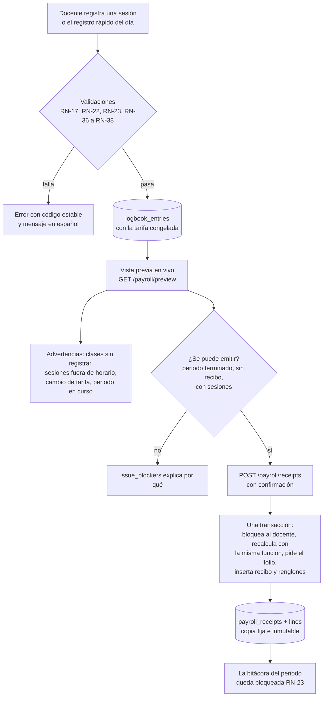
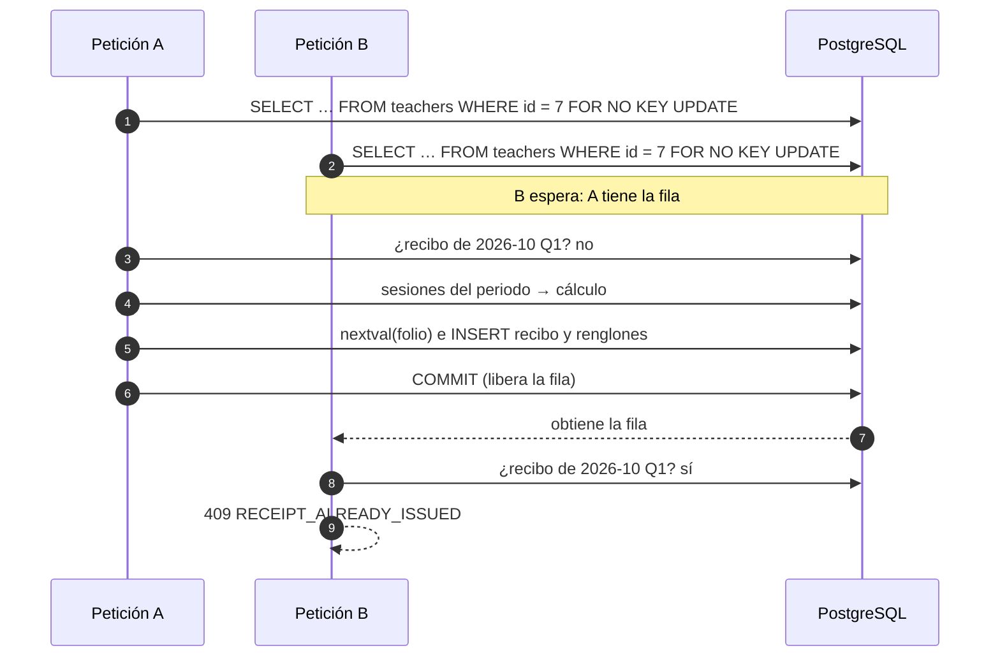
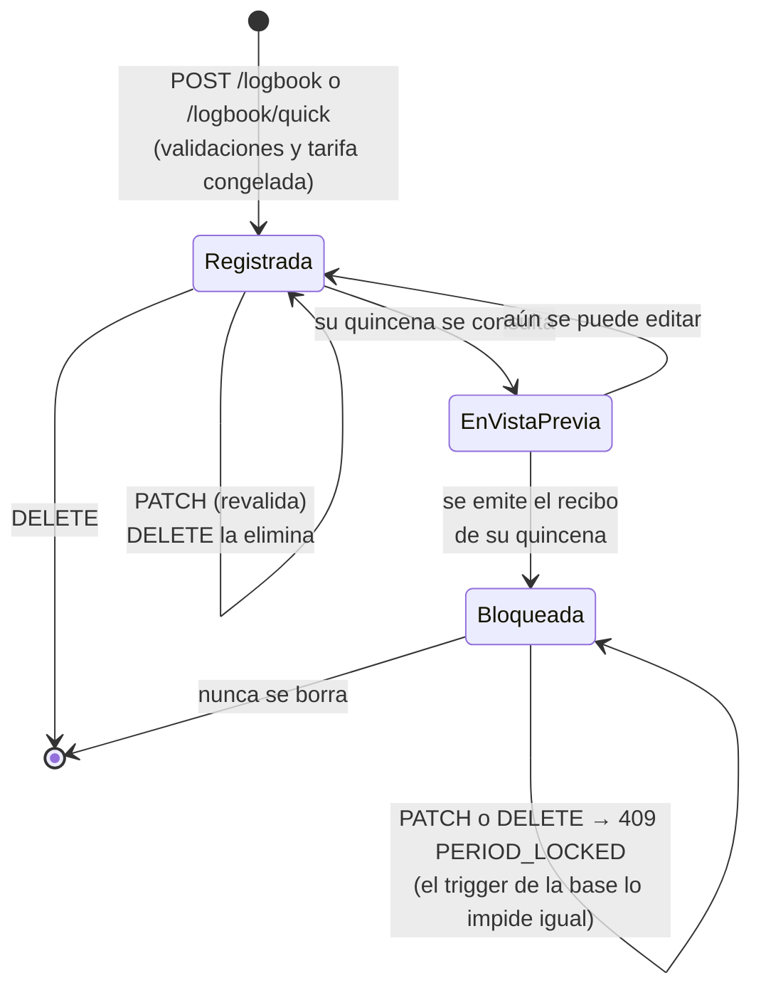

# Reglas de negocio del Sistema de Nómina Docente

Este documento explica cada regla de negocio (`RN-XX`), dónde se valida y qué prueba automatizada la demuestra; la fórmula del cálculo de la nómina con un ejemplo completo, y los flujos de la bitácora al recibo. La lista breve de las reglas vive en [`CLAUDE.md`](../CLAUDE.md#2-reglas-de-negocio); los contratos de la API en [`api.md`](api.md) y el esquema en [`base-de-datos.md`](base-de-datos.md).

**Principio rector:** el sistema **impide** los errores en lugar de solo reportarlos. Cada regla se valida en el nivel más temprano posible (para dar un mensaje claro) y en la base de datos cuando es un invariante de los datos (para que nada la rompa, ni siquiera dos peticiones simultáneas).

## 1. Dónde se valida cada regla

Columnas: **F** = frontend (Zod, en `frontend/src/features/*/schemas/`), **B** = backend (servicios en `backend/src/app/services/` y dominio en `backend/src/app/domain/`), **BD** = base de datos (restricciones y triggers). Abreviaturas de las pruebas: `api/` = `backend/tests/integration/api/v1/routers/`, `mod/` = `backend/tests/integration/models/`, `dom/` = `backend/tests/unit/domain/`, `svc/` = `backend/tests/integration/services/`, `seeds/` = `backend/tests/integration/seeds/`.

### 1.1 Docentes y aislamiento

| Regla | Explicación | F | B | BD | Prueba |
| --- | --- | --- | --- | --- | --- |
| RN-01 Registro | Nombre(s), apellidos, correo, número de empleado opcional y contraseña | Formulario de registro | `AuthService.register` | `CHECK` de textos | `api/test_auth_register.py::test_creates_account_profile_role_and_session` |
| RN-02 Correo único | Se compara en minúsculas y sin espacios | Normaliza | `normalize_email` | `UNIQUE` + `CHECK email = lower(btrim(email))` | `api/test_auth_register.py::test_duplicate_email_is_rejected_ignoring_case` |
| RN-03 Número de empleado | Opcional y único | Patrón | Servicio | `UNIQUE` (admite varios `NULL`) | `api/test_auth_register.py::test_duplicate_employee_number_is_rejected` |
| RN-04 Aislamiento | Cada docente solo ve y modifica lo suyo; lo ajeno responde 404 | — | Toda consulta se filtra por el docente autenticado | FK compuestas `(…, teacher_id)` | `api/test_isolation.py` (lectura, edición, borrado, cambio de estado y uso en registros propios de cada recurso) |

### 1.2 Catálogos

| Regla | Explicación | F | B | BD | Prueba |
| --- | --- | --- | --- | --- | --- |
| RN-05 Carreras | Catálogo con clave, nombre, tipo y estado, cargado por semillas | — | — | `UNIQUE`, `CHECK` de clave | `seeds/test_runner.py::test_loads_the_official_catalogs` |
| RN-06 Selección | La carrera se elige de un selector; los docentes no la editan | Selector (`useCareers`) | Rechaza claves inexistentes o inactivas | FK | `api/test_assignments.py::TestCreate::test_only_catalog_values_are_accepted` |
| RN-07 Baja lógica | Una carrera inactiva no aparece en selectores pero sí en el historial | — | `CareerRepository.list_active` | `is_active` | `api/test_catalogs.py::test_careers_lists_only_active_careers_sorted_by_name` |
| RN-10 Tarifas | Catálogo ($125, $135, $145) ampliable sin código | Selector (`useHourlyRates`) | — | `UNIQUE`, `CHECK > 0` | `api/test_catalogs.py::test_hourly_rates_are_decimal_strings_in_ascending_order` |
| RN-11 Selector de tarifas | Se rechaza una tarifa inexistente o inactiva | Selector | `RATE_NOT_FOUND`, `RATE_INACTIVE` | FK | `api/test_assignments.py::TestCreate::test_rejects_inactive_rate` |
| RN-12 Tarifa inmutable | El importe nunca cambia; se desactiva y se crea otra | — | — | Trigger `trg_hourly_rates_amount_immutable` | `mod/test_catalogs.py::test_hourly_rate_amount_cannot_change` |

### 1.3 Materias

| Regla | Explicación | F | B | BD | Prueba |
| --- | --- | --- | --- | --- | --- |
| RN-08 Materias del docente | Cada docente registra sus materias una vez y las reutiliza | — | `SubjectService` | FK al docente | `api/test_subjects.py::TestCreate::test_two_teachers_can_register_the_same_name` |
| RN-09 Sin duplicados | Sin distinguir mayúsculas, acentos ni espacios. El nombre se guarda con espacios simples y mayúsculas coherentes («bases   de datos» → «Bases de Datos») | Colapsa espacios | `format_subject_name` y búsqueda por `normalize_name` | `UNIQUE (teacher_id, name_normalized)` (columna generada) | `api/test_subjects.py::TestCreate::test_rejects_duplicates_ignoring_case_accents_and_spaces`, `dom/test_subjects.py` |
| RN-32 Baja de materias | Sin asignaciones: se borra. Con historial: se desactiva (y se puede reactivar). Con asignaciones activas: 409 hasta desactivarlas | — | `SubjectService.remove` | FK `RESTRICT` | `api/test_subjects.py::TestRemoval` |

### 1.4 Asignaciones

| Regla | Explicación | F | B | BD | Prueba |
| --- | --- | --- | --- | --- | --- |
| RN-13 Definición | Docente + materia + carrera + tarifa | Tres selectores | `AssignmentService.create` | FK compuesta materia–docente | `api/test_assignments.py::TestCreate::test_joins_subject_career_and_rate` |
| RN-14 Unicidad | Una sola asignación activa por materia y carrera | — | `ASSIGNMENT_ALREADY_EXISTS` | Índice único parcial `WHERE is_active` | `api/test_assignments.py::TestCreate::test_rejects_a_second_active_assignment_of_the_same_subject_and_career` |
| RN-15 Borrado protegido | Con bitácora no se borra (solo se desactiva); sin bitácora se borra con sus horarios | Confirmación (etapa 7) | `ASSIGNMENT_HAS_LOGBOOK` | FK `RESTRICT` desde la bitácora, `CASCADE` a horarios | `api/test_assignments.py::TestLifecycle::test_delete_with_logbook_is_rejected` |
| RN-33 Tarifa congelada en la sesión | Cada sesión guarda la tarifa vigente al registrarla. Cambiar la tarifa de la asignación solo afecta a las sesiones posteriores; las registradas y los recibos no cambian | — | `LogbookService._build_entry` | `logbook_entries.hourly_rate_id` (FK a una tarifa inmutable) | `api/test_assignments.py::TestRateChange::test_rate_change_does_not_alter_registered_sessions` |
| RN-34 Cambio de materia o carrera | Solo sin bitácora: con historial cambiaría el sentido de sesiones ya registradas | — | `AssignmentService.update` | — | `api/test_assignments.py::TestRateChange::test_subject_or_career_cannot_change_with_logbook` |
| RN-35 Desactivación | Guarda el último día activo (`active_until`, hoy) y elimina sus horarios; la bitácora y los recibos se conservan. Reactivar exige materia, carrera y tarifa vigentes | — | `deactivate`, `reactivate` | `CHECK is_active = (active_until IS NULL)` | `api/test_assignments.py::TestLifecycle::test_deactivate_keeps_history_removes_schedules_and_allows_a_new_one` |

### 1.5 Horarios

| Regla | Explicación | F | B | BD | Prueba |
| --- | --- | --- | --- | --- | --- |
| RN-16 Horario semanal | Día ISO (1–7), entrada y salida | Selector de día, `HH:MM` | `ScheduleService` | `CHECK weekday BETWEEN 1 AND 7`, sin segundos | `api/test_schedules.py::TestCreate::test_rejects_malformed_input` |
| RN-17 Salida posterior | La salida es posterior a la entrada; no se cruza la medianoche | `checkClassTimes` | `TIME_RANGE_INVALID` | `CHECK end_time > start_time` | `api/test_schedules.py::TestCreate::test_duration_rules` |
| RN-18 Sin empalmes | Con **todas** las clases del docente; intervalos `[entrada, salida)`. El error dice con qué clase choca | — (lo sabe el servidor) | `SCHEDULE_OVERLAP` con `details.conflicts` | `EXCLUDE USING gist` | `api/test_schedules.py::TestCreate::test_overlap_with_another_assignment_names_the_class`, `dom/test_time_ranges.py` |
| RN-36 Duración de una clase | Entre `CLASS_MIN_DURATION_MINUTES` y `CLASS_MAX_DURATION_MINUTES` (configurables; 30 y 300). Aplica a horarios y sesiones | Con las reglas de `GET /catalogs/business-rules` | `CLASS_TOO_SHORT`, `CLASS_TOO_LONG` | — | `api/test_schedules.py::TestCreate::test_duration_rules` |

### 1.6 Bitácora

| Regla | Explicación | F | B | BD | Prueba |
| --- | --- | --- | --- | --- | --- |
| RN-19 Sesiones impartidas | Fecha, asignación, entrada, salida y observaciones. Minutos y horas los calcula el servidor | — | `LogbookService.create` | — | `api/test_logbook.py::TestCreate::test_server_computes_minutes_hours_and_freezes_the_rate` |
| RN-20 Captura por selección | Se elige la asignación; nada se vuelve a escribir | Selector | Rechaza campos extra (`minutes`, `amount`) | — | `api/test_logbook.py::TestCreate::test_client_cannot_send_hours_or_amounts` |
| RN-21 Precarga | `GET /logbook/scheduled?date=` devuelve las clases de ese día de la semana con sus horas y si ya están registradas | `useScheduledClasses` | `scheduled_for_date` | — | `api/test_logbook.py::TestScheduledClasses` |
| RN-22 Validaciones | Sin fecha futura (y si es hoy, la clase ya terminó), sin empalmes con otras sesiones del día, duración válida | Fecha ≤ hoy | `SESSION_DATE_IN_FUTURE`, `SESSION_NOT_FINISHED`, `SESSION_OVERLAP` | `EXCLUDE USING gist` | `api/test_logbook.py::TestCreate::test_session_rules`, `test_overlapping_sessions_on_the_same_day_are_rejected` |
| RN-23 Periodo emitido | No se crea, edita, mueve ni borra una sesión de una quincena con recibo | — | `PERIOD_LOCKED` | Trigger `trg_logbook_entries_period_locked` | `api/test_logbook.py::TestUpdateAndDelete::test_locked_sessions_cannot_be_edited_or_deleted`, `mod/test_logbook_entry.py::TestIssuedPeriodLock` |
| RN-37 Antigüedad máxima | Solo se registran sesiones de los últimos `LOGBOOK_MAX_AGE_DAYS` días (30). Aplica al crear y al cambiar la fecha; editar las observaciones de una sesión antigua sí se permite | Fecha ≥ hoy − N | `SESSION_DATE_TOO_OLD` | — | `api/test_logbook.py::TestUpdateAndDelete::test_notes_only_edit_of_an_old_session_is_allowed` |
| RN-38 Asignación activa en la fecha | Una asignación desactivada acepta sesiones con fecha hasta su último día activo | — | `ASSIGNMENT_INACTIVE_ON_DATE` | — | `api/test_logbook.py::TestCreate::test_session_after_deactivation_date_is_rejected` |
| RN-39 Sesión fuera de horario | Se registra, pero con advertencia `SESSION_NOT_SCHEDULED` o `SESSION_TIMES_DIFFER` | Muestra la advertencia | `_schedule_warnings` | — | `api/test_logbook.py::TestCreate::test_different_times_are_accepted_with_a_warning` |
| RN-40 Registro rápido | Varias clases programadas de un día en una transacción: todo o nada; `details.entry_index` indica la que falló | — | `quick_register` | Transacción | `api/test_logbook.py::TestQuickRegister::test_is_all_or_nothing` |

### 1.7 Recibo de nómina

| Regla | Explicación | F | B | BD | Prueba |
| --- | --- | --- | --- | --- | --- |
| RN-24 Periodo quincenal | Días 1–15 y 16–último (28, 29, 30 o 31) | — | `app/domain/periods.py` | `CHECK` de `period_start` y `period_end` | `dom/test_periods.py` (todas las quincenas del año, febrero normal y bisiesto, días 15 y 16) |
| RN-25 Cálculo automático | Por asignación y tarifa: `minutos × tarifa / 60` | — | `app/domain/payroll.py` | `CHECK amount = round(minutes * hourly_rate / 60, 2)` | `dom/test_payroll.py`, `api/test_payroll.py::TestPreview::test_calculates_lines_and_totals_with_exact_rounding` |
| RN-26 Dinero exacto | `Decimal` y `NUMERIC`, redondeo `ROUND_HALF_UP` por renglón; total = suma de renglones. En JSON viajan como cadenas | Formatea cadenas sin convertir a número | `app/domain/money.py` (único módulo que redondea) | `NUMERIC` | `dom/test_money.py` (50 y 90 minutos, medio centavo, sumas) |
| RN-27 Contenido del recibo | Institución, folio, periodo, docente, renglones y totales | — | `GET /payroll/receipts/{id}` | Copias en el recibo | `api/test_payroll.py::TestIssue::test_issued_receipt_matches_the_preview_exactly` |
| RN-28 Vista previa y emisión | Vista previa en vivo; la emisión guarda una copia fija que ya no cambia | Confirmación (etapa 8) | `PayrollService.preview`, `issue` | Triggers de inmutabilidad | `api/test_payroll.py::TestIssue::test_receipt_is_a_fixed_copy` |
| RN-29 Un recibo por periodo | Solo periodos terminados (o el en curso si `PAYROLL_ISSUE_REQUIRES_CLOSED_PERIOD=false`), nunca futuros, con al menos una sesión, una sola vez. Seguro ante emisiones simultáneas | — | Bloqueo de la fila del docente + validaciones | `UNIQUE (teacher_id, year, month, fortnight)` | `api/test_payroll.py::TestIssue`, `svc/test_payroll_concurrency.py` |
| RN-30 Folio | `{PREFIJO}-{AAAA}{MM}-Q{n}-{consecutivo}`; el consecutivo lo da una secuencia de la base | — | `build_folio` | Secuencia, `UNIQUE` | `api/test_payroll.py::TestIssue::test_folios_are_unique_and_consecutive` |
| RN-31 Fuera de alcance | No se calculan ISR, IMSS ni deducciones | — | — | — | — |

## 2. Cálculo de la nómina

### 2.1 Fórmula

Para una quincena:

1. Se toman las sesiones de la bitácora del docente con fecha dentro del periodo.
2. Se agrupan por **asignación y tarifa** (la tarifa congelada en cada sesión).
3. Por renglón: `minutos = Σ (salida − entrada)` de sus sesiones, en minutos enteros.
4. `horas = minutos / 60`, redondeadas a 2 decimales (`ROUND_HALF_UP`).
5. `importe = minutos × tarifa / 60`, calculado con decimales exactos y redondeado **una vez** a centavos (`ROUND_HALF_UP`).
6. `total bruto = Σ importes` de los renglones ya redondeados.
7. `horas totales = minutos totales / 60`, redondeadas (igual que la columna generada de la base).

Redondear sobre los minutos acumulados, y no sesión por sesión, evita sumar errores de redondeo: dos sesiones de 50 minutos a $125.00 son 100 minutos → **$208.33**, mientras que redondear cada sesión daría $104.17 × 2 = $208.34.

### 2.2 Ejemplo completo

Recibo de la 1.ª quincena de octubre de 2026 (1 al 15 de octubre) de un docente con tres asignaciones:

| Asignación | Sesiones | Minutos | Horas | Tarifa | Cálculo del importe | Importe |
| --- | --- | --- | --- | --- | --- | --- |
| Bases de Datos · Ing. en Sistemas Computacionales | 5 y 12 de octubre, 07:00–07:50 | 50 + 50 = 100 | 100 / 60 = 1.666… → **1.67** | $125.00 | 100 × 125 / 60 = 208.333… | **$208.33** |
| Cálculo · Lic. en Administración | 15 de octubre, 16:00–16:50 | 50 | 0.833… → **0.83** | $145.00 | 50 × 145 / 60 = 120.833… | **$120.83** |
| Redes · Ing. Industrial | 6 de octubre, 10:00–11:30 | 90 | **1.50** | $135.00 | 90 × 135 / 60 = 202.5 | **$202.50** |
| **Total** | 4 sesiones | **240** | 240 / 60 = **4.00** | | 208.33 + 120.83 + 202.50 | **$531.66** |

Es el caso de la prueba `api/test_payroll.py::TestPreview::test_calculates_lines_and_totals_with_exact_rounding`, y la emisión (`test_issued_receipt_matches_the_preview_exactly`) comprueba que el recibo emitido tiene exactamente los mismos renglones y totales.

### 2.3 Cambio de tarifa dentro de la quincena

Si la tarifa de «Bases de Datos» cambia de $125.00 a $145.00 el día 17, la sesión del lunes 19 registrada antes del cambio conserva $125.00 y la del miércoles 21, registrada después, toma $145.00. La vista previa muestra dos renglones de la misma asignación (cada uno con su tarifa) y la advertencia `ASSIGNMENT_RATE_CHANGED`. Prueba: `api/test_assignments.py::TestRateChange::test_rate_change_does_not_alter_registered_sessions`.

## 3. Flujos

### 3.1 De la bitácora al recibo

### 3.2 Emisión segura ante concurrencia

El registro de una sesión toma el mismo bloqueo: si llega mientras se emite el recibo de su quincena, espera y después se rechaza con `PERIOD_LOCKED`. Así ninguna sesión puede quedar fuera de un recibo que ya la debía incluir.

### 3.3 Ciclo de vida de una sesión

## 4. Configuración de las reglas

Los límites institucionales son variables de entorno obligatorias (`backend/.env.example`) y se publican en `GET /api/v1/catalogs/business-rules`, de modo que el frontend valida con los mismos valores sin duplicarlos. Los límites de periodo (días 15 y 16), la zona horaria y los formatos son constantes del código (`backend/src/app/core/constants.py`), porque son reglas de la nómina y no del despliegue.

| Variable | Valor recomendado | Regla |
| --- | --- | --- |
| `CLASS_MIN_DURATION_MINUTES` | 30 | RN-36 |
| `CLASS_MAX_DURATION_MINUTES` | 300 | RN-36 |
| `LOGBOOK_MAX_AGE_DAYS` | 30 | RN-37 |
| `PAYROLL_ISSUE_REQUIRES_CLOSED_PERIOD` | `true` | RN-29 |
| `PAYROLL_FOLIO_PREFIX` | `NOM` | RN-30 |
