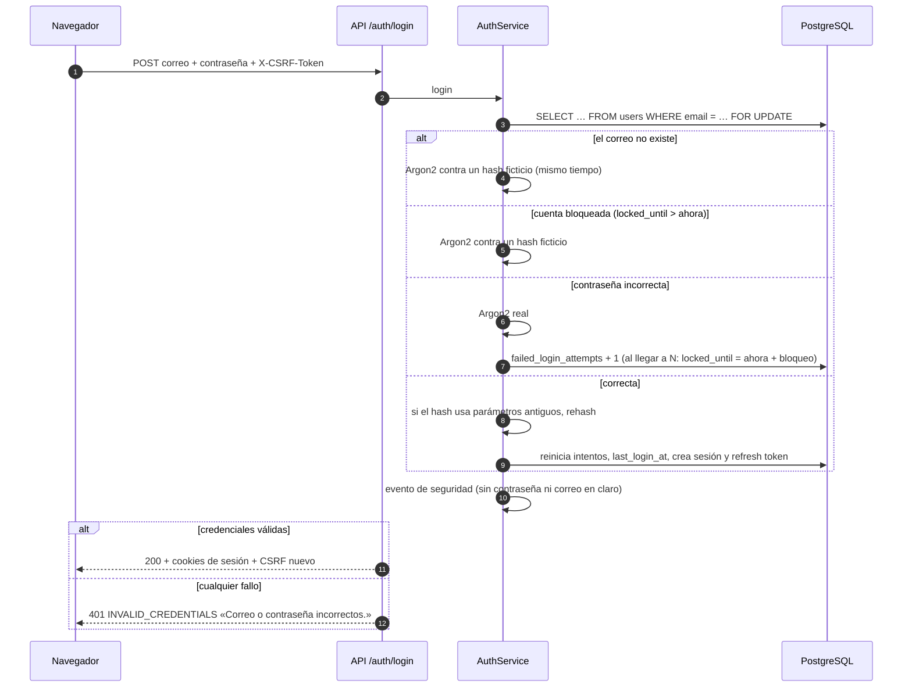
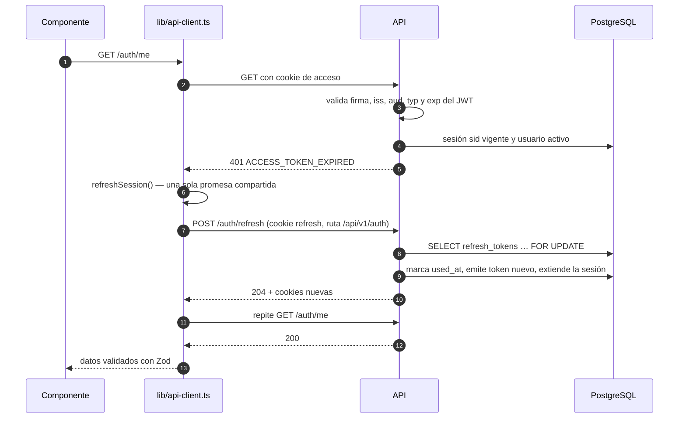
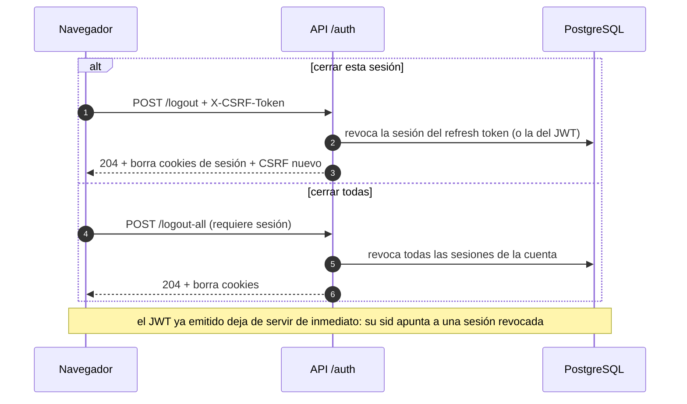

# Seguridad del Sistema de Nómina Docente

Este documento describe cómo el sistema protege las cuentas y los datos de nómina: autenticación, sesiones, protección contra CSRF, endurecimiento HTTP y registro de eventos. Incluye los diagramas de cada flujo, la relación de amenazas y mitigaciones (OWASP Top 10) y las limitaciones conocidas. Las reglas de negocio están en [`CLAUDE.md`](../CLAUDE.md), la arquitectura en [`arquitectura.md`](arquitectura.md) y el esquema en [`base-de-datos.md`](base-de-datos.md).

## 1. Resumen

| Aspecto | Decisión |
| --- | --- |
| Contraseñas | Argon2id (pwdlib) con rehash transparente; política configurable publicada por la API |
| Sesión | JWT de acceso de 15 minutos + refresh token opaco de 7 días, ambos en cookies `HttpOnly` |
| Revocación | El JWT lleva el identificador de la sesión (`sid`); cada petición comprueba en la base que siga vigente |
| Refresh token | Solo su hash SHA-256 en la base; rotación en cada uso; el reuso revoca todas las sesiones |
| Fuerza bruta | Bloqueo temporal de la cuenta tras N intentos fallidos, persistido en la base |
| Enumeración de cuentas | Mismo mensaje y tiempo de respuesta similar exista o no el correo |
| CSRF | *Double-submit* (cookie legible + encabezado `X-CSRF-Token`) en toda petición que modifica datos, más validación de `Origin` |
| Endurecimiento | Cabeceras de seguridad, CSP estricta para la API, límite de tamaño, Pydantic estricto, errores sin detalles internos |
| Auditoría | Logger `app.security` con eventos estructurados, sin contraseñas, tokens ni correos en claro |

## 2. Cookies

| Cookie (variable) | Contenido | HttpOnly | Path | Vida |
| --- | --- | --- | --- | --- |
| `ACCESS_COOKIE_NAME` | JWT de acceso | sí | `/` | `ACCESS_TOKEN_EXPIRE_MINUTES` |
| `REFRESH_COOKIE_NAME` | Refresh token opaco (256 bits aleatorios) | sí | `/api/v1/auth` | `REFRESH_TOKEN_EXPIRE_DAYS` |
| `SESSION_HINT_COOKIE_NAME` | `1` (no es una credencial) | sí | `/` | igual que el refresh |
| `CSRF_COOKIE_NAME` | Token CSRF aleatorio | **no** | `/` | igual que el refresh |

Todas llevan `SameSite` (`AUTH_COOKIE_SAMESITE`, `lax` por defecto) y `Secure` (`AUTH_COOKIE_SECURE`, obligatorio en producción: el backend no inicia sin él). El navegador solo habla con Next.js (`localhost:3000`), que reenvía `/api/v1/*` al backend, así que todas son cookies de primera parte.

- La cookie de **refresh** tiene ruta restringida: el navegador solo la envía a las rutas de autenticación, nunca a las de negocio.
- La cookie **indicadora** existe porque el proxy de Next.js (`src/proxy.ts`) no puede ver la de refresh (otra ruta) y la de acceso dura solo 15 minutos. El proxy la usa únicamente para decidir redirecciones; la autorización real siempre la hace la API.
- La cookie **CSRF** es legible a propósito: el frontend la copia en el encabezado. Se renueva al iniciar y al cerrar sesión.

## 3. Flujos

### 3.1 Registro

```mermaid
sequenceDiagram
    autonumber
    participant N as Navegador
    participant P as Next.js (proxy)
    participant A as API /auth
    participant S as AuthService
    participant DB as PostgreSQL

    N->>P: GET /api/v1/auth/password-policy
    P->>A: reenvía
    A-->>N: min_length, max_length, rules
    N->>N: valida el formulario con Zod (requisitos del servidor)
    N->>P: GET /api/v1/auth/csrf (si no hay cookie CSRF)
    A-->>N: Set-Cookie csrf
    N->>P: POST /api/v1/auth/register + X-CSRF-Token
    P->>A: reenvía (cookies y encabezados)
    A->>A: CsrfMiddleware: Origin permitido y encabezado = cookie
    A->>S: register(datos normalizados)
    S->>S: política de contraseñas (longitud, letra, número, datos personales, comunes)
    S->>DB: ¿correo o número de empleado ya registrados?
    S->>DB: BEGIN; INSERT users, user_roles (teacher), teachers, auth_sessions, refresh_tokens; COMMIT
    S-->>A: perfil + tokens
    A-->>N: 201 + Set-Cookie acceso, refresh, indicador y CSRF nuevo
    N->>P: GET /panel (con cookie indicadora)
```

Si cualquier paso falla, la transacción se revierte completa: no quedan cuentas sin perfil ni perfiles sin rol. Si dos registros simultáneos usan el mismo correo, la restricción `UNIQUE` de la base decide y el segundo recibe el mismo error `EMAIL_ALREADY_REGISTERED`.

### 3.2 Inicio de sesión



Correo inexistente, contraseña incorrecta, cuenta bloqueada y cuenta desactivada responden **igual**, y siempre se calcula un hash Argon2, así que ni el mensaje ni el tiempo revelan qué cuentas existen. El bloqueo vive en la base: sobrevive a reinicios y aplica aunque haya varias instancias. El texto del frontend avisa que tras varios intentos el acceso se bloquea unos minutos.

### 3.3 Petición autenticada con renovación automática



Si varias peticiones reciben 401 al mismo tiempo, todas esperan la **misma** renovación (no hay renovaciones duplicadas). Si la renovación falla, el backend borra las cookies de sesión y el cliente avisa a `SessionExpiryHandler`, que limpia la caché y lleva a `/iniciar-sesion?siguiente=<página actual>`. El parámetro `siguiente` solo acepta rutas internas (`safeInternalPath`), para evitar redirecciones abiertas.

### 3.4 Detección de reuso del refresh token

```mermaid
sequenceDiagram
    autonumber
    participant V as Navegador de la víctima
    participant X as Atacante (copia del token R1)
    participant A as API /auth/refresh
    participant DB as PostgreSQL

    V->>A: refresh con R1
    A->>DB: R1.used_at = ahora; emite R2
    A-->>V: 204 (R2)
    Note over X: pasa la tolerancia (REFRESH_TOKEN_REUSE_GRACE_SECONDS)
    X->>A: refresh con R1
    A->>DB: R1 ya está usado → reuso
    A->>DB: revoca TODAS las sesiones del usuario (refresh_token_reused)
    A-->>X: 401 SESSION_INVALID + borra cookies
    V->>A: GET /auth/me (sesión revocada)
    A-->>V: 401 → no puede renovar → iniciar sesión
```

Un token ya rotado solo puede presentarse si alguien lo copió. Como no se sabe cuál de los dos es el legítimo, se revocan **todas** las sesiones de la cuenta: el atacante pierde el acceso y la víctima vuelve a iniciar sesión con su contraseña (que el atacante no tiene).

**Tolerancia entre pestañas.** Dos pestañas pueden renovar casi a la vez con el mismo token. Dentro de `REFRESH_TOKEN_REUSE_GRACE_SECONDS` (10 s) el segundo intento recibe `409 SESSION_REFRESH_CONFLICT` sin revocar nada; como las cookies nuevas ya están en el navegador, el cliente lo trata como éxito y repite la petición. La fila del token se bloquea (`FOR UPDATE`), así que dos renovaciones simultáneas nunca emiten dos tokens válidos.

### 3.5 Cierre de sesión



`logout` es idempotente (204 aunque no haya sesión). `change-password` exige la contraseña actual, aplica la política (y que la nueva sea distinta), y revoca las **demás** sesiones; la actual sigue activa. Un error en la contraseña actual cuenta como intento fallido: una sesión robada no sirve para adivinar la contraseña.

## 4. Reglas de acceso

- Toda ruta de negocio declara `CurrentTeacher` (o `CurrentUser`, o `require_roles(...)`) de `api/v1/dependencies.py`.
  - `get_current_user`: 401 si no hay cookie de acceso, si el JWT no es válido o expiró, o si la sesión fue revocada o la cuenta desactivada.
  - `get_current_teacher`: además, 403 `TEACHER_PROFILE_REQUIRED` si la cuenta no tiene perfil de docente.
  - `require_roles(RoleCode.ADMIN, …)`: 403 `PERMISSION_DENIED` si la cuenta no tiene ninguno de los roles activos.
- **Un docente solo accede a sus propios datos (RN-04).** Ninguna ruta acepta el identificador del docente desde la petición: el servicio recibe el docente autenticado y filtra por él. Un recurso que existe pero es de otro docente responde 404.
- La API expone `public_id` (UUID), nunca el `id` secuencial.

## 5. Política de contraseñas

Definida una sola vez en `backend/src/app/core/security/password_policy.py` y publicada en `GET /api/v1/auth/password-policy`; el frontend construye su validación y la lista de requisitos con esa respuesta.

| Regla | Código | Dónde se revisa |
| --- | --- | --- |
| Al menos `PASSWORD_MIN_LENGTH` caracteres (12) | `min_length` | navegador y servidor |
| Como máximo 128 caracteres (evita gastar CPU en Argon2) | `max_length` | navegador y servidor |
| Al menos una letra | `letter_required` | navegador y servidor |
| Al menos un número | `digit_required` | navegador y servidor |
| No contener nombre, apellidos ni la parte local del correo (sin distinguir mayúsculas ni acentos; partes de 3 o más caracteres) | `no_personal_data` | servidor |
| No estar en la lista de contraseñas comunes ([`common-passwords.txt`](../backend/src/app/core/security/data/common-passwords.txt)) | `not_common` | servidor |
| Ser distinta de la actual (solo al cambiarla) | `not_current` | servidor |

El servidor responde `422 PASSWORD_POLICY_VIOLATION` con `details.rules` (los códigos incumplidos); el frontend los traduce a texto en español junto al campo. Las contraseñas nunca se recortan, nunca se registran y nunca se devuelven en un error (los errores de validación no incluyen el valor recibido).

## 6. Amenazas y mitigaciones (OWASP Top 10:2025)

| Riesgo | Amenaza concreta | Mitigación | Dónde |
| --- | --- | --- | --- |
| A01 Control de acceso roto | Un docente lee o modifica datos de otro; acceso sin sesión | Dependencias `get_current_user`/`get_current_teacher`/`require_roles`; filtrado por docente en servicios y repositorios; 404 para recursos ajenos; FK compuestas que impiden mezclar datos de dos docentes; `public_id` UUID | `api/v1/dependencies.py`, `services/`, `docs/base-de-datos.md` §3.1 |
| A01 (CSRF) | Otro sitio hace que el navegador envíe una petición con la cookie de sesión | *Double-submit* con comparación en tiempo constante en todos los métodos que modifican datos (incluidos login y registro); validación de `Origin`; `SameSite=Lax` | `core/security/middleware.py` (`CsrfMiddleware`), `lib/api-client.ts` |
| A02 Configuración insegura | Cookies sin `Secure` en producción; algoritmo JWT `none`; secretos débiles; documentación expuesta | `Settings` falla al iniciar si falta una variable, si `JWT_SECRET` < 32 caracteres, si el algoritmo no es HMAC, si `SameSite=none` o si `Secure` es falso en producción; OpenAPI deshabilitado en producción | `core/config.py`, `main.py` |
| A02 (cabeceras) | *Clickjacking*, *MIME sniffing*, fuga de la URL, caché de datos de nómina | `X-Frame-Options: DENY`, CSP `frame-ancestors 'none'`, `nosniff`, `Referrer-Policy`, `Permissions-Policy`, `Cache-Control: no-store`, COOP/CORP, HSTS en producción; cabeceras básicas también en las páginas de Next.js | `SecurityHeadersMiddleware`, `frontend/src/config/security-headers.ts` |
| A03 Fallas de la cadena de suministro | Dependencia comprometida o vulnerable | Versiones fijadas en `uv.lock` y `package-lock.json`; sin `--legacy-peer-deps`; origen de paquetes nuevos verificado | `backend/uv.lock`, `frontend/package-lock.json` |
| A04 Fallas criptográficas | Robo de la base con contraseñas o tokens | Argon2id con rehash; refresh tokens solo como SHA-256 (256 bits aleatorios); JWT HMAC con secreto ≥ 32 caracteres; `iss`, `aud`, `typ` y `exp` obligatorios | `core/security/passwords.py`, `core/security/tokens.py` |
| A05 Inyección | SQL, XSS | SQLAlchemy con parámetros (sin SQL concatenado con datos); validación estricta de Pydantic (patrones de nombres, correos) y Zod; React escapa el contenido; la API solo responde JSON con CSP `default-src 'none'` | `schemas/auth.py`, `features/auth/schemas/` |
| A06 Diseño inseguro | Carreras entre pestañas que cierran la sesión; mezcla de datos entre docentes | Tolerancia de reuso con bloqueo de fila; invariantes en la base (único token sin usar por sesión, FK compuestas) | `services/sessions.py`, migración `067cd1ed562c` |
| A07 Fallas de autenticación | Fuerza bruta, enumeración de cuentas, robo de sesión, sesiones eternas | Bloqueo temporal persistente; mensaje genérico y tiempo similar; política de contraseñas; JWT de 15 min revocable al instante; rotación y detección de reuso del refresh token; cookies `HttpOnly`; `logout-all`; cambio de contraseña revoca las demás sesiones | `services/auth.py`, `services/login_throttle.py`, `services/sessions.py` |
| A08 Integridad de datos | Manipulación del JWT o de campos no previstos (p. ej. `is_admin`) | Firma verificada con algoritmo fijo; `extra="forbid"` en toda entrada; el rol se asigna en el servidor buscándolo por su clave | `core/security/tokens.py`, `schemas/auth.py` |
| A09 Registro y alertas | Ataques que pasan inadvertidos; filtración de datos en los registros | Eventos `app.security` (registro, inicios correctos y fallidos, bloqueo, reuso, cambio de contraseña, cierres) con `request_id`; fallos como `WARNING`; correo como huella SHA-256 truncada; nunca contraseñas ni tokens (prueba automatizada) | `core/security/audit.py` |
| A10 Manejo de condiciones excepcionales | Trazas, SQL o rutas internas en las respuestas; denegación de servicio con cuerpos enormes | Manejador central: formato único de error en español, 500 genérico sin detalles; límite de tamaño de cuerpo (413) incluso sin `Content-Length`; IP inválida o *user agent* largo no rompen la petición | `core/exceptions.py`, `BodySizeLimitMiddleware`, `dependencies.py` |

## 7. Configuración

Todas las variables son obligatorias (sin valores por defecto en el código). Los valores recomendados están en [`backend/.env.example`](../backend/.env.example).

| Variable | Recomendado | Efecto |
| --- | --- | --- |
| `JWT_SECRET` | aleatorio, ≥ 32 caracteres | Firma del JWT. Cambiarlo invalida todos los tokens de acceso |
| `JWT_ALGORITHM` | `HS256` | Solo `HS256`, `HS384` o `HS512` |
| `ACCESS_TOKEN_EXPIRE_MINUTES` | `15` | Vida del JWT de acceso |
| `REFRESH_TOKEN_EXPIRE_DAYS` | `7` | Vida del refresh token; se renueva en cada uso |
| `REFRESH_TOKEN_REUSE_GRACE_SECONDS` | `10` | Tolerancia para renovaciones simultáneas entre pestañas (`0` la desactiva) |
| `ACCESS_COOKIE_NAME`, `REFRESH_COOKIE_NAME`, `SESSION_HINT_COOKIE_NAME`, `CSRF_COOKIE_NAME` | `nomina_access`, `nomina_refresh`, `nomina_session`, `nomina_csrf` | Deben ser distintos; los dos últimos deben coincidir con el frontend |
| `AUTH_COOKIE_SECURE` | `true` con HTTPS | Obligatorio en producción |
| `AUTH_COOKIE_SAMESITE` | `lax` | `lax` o `strict` |
| `LOGIN_MAX_FAILED_ATTEMPTS` | `5` | Intentos fallidos seguidos antes del bloqueo |
| `LOGIN_LOCKOUT_MINUTES` | `15` | Duración del bloqueo |
| `PASSWORD_MIN_LENGTH` | `12` | Entre 8 y 128 |
| `MAX_REQUEST_BODY_BYTES` | `65536` | Tamaño máximo del cuerpo de una petición |
| `CORS_ORIGINS` | `http://localhost:3000` | Orígenes permitidos para CORS y para la validación de `Origin` |

En el frontend: `NEXT_PUBLIC_CSRF_COOKIE_NAME` (= `CSRF_COOKIE_NAME`) y `SESSION_HINT_COOKIE_NAME` (solo servidor, = la del backend).

## 8. Limitaciones conocidas y mejoras futuras

| Limitación | Por qué | Mejora prevista |
| --- | --- | --- |
| No hay recuperación de contraseña por correo | No hay servidor de correo institucional en esta versión | Enlace de un solo uso con expiración corta, guardado como hash, enviado por SMTP institucional |
| El registro revela si un correo ya tiene cuenta | Es necesario para dar un error claro (requisito de RN-02) | Con correo disponible: responder siempre «revisa tu correo» y confirmar la cuenta por enlace |
| El bloqueo es por cuenta, no por IP | No hay límite de peticiones por origen | Limitador por IP y por ruta (p. ej. en un proxy inverso) antes del despliegue |
| No hay segundo factor (MFA) | Fuera del alcance | TOTP opcional para docentes y obligatorio para administradores |
| La CSP de las páginas de Next.js es básica | La CSP estricta con *nonces* requiere ajustar el render | Etapa 10 |
| Cookies sin prefijo `__Host-` en desarrollo | El prefijo exige `Secure` (HTTPS) | En producción, nombres `__Host-nomina_access`, etc. (son configurables) |
| CSRF *double-submit* no firmado | Suficiente con un solo origen y `SameSite`; un subdominio comprometido podría sembrar la cookie | Token CSRF firmado con HMAC y ligado a la sesión |
| La lista de contraseñas comunes es corta | Se versiona en el repositorio | Consulta con *k-anonymity* a una base de contraseñas filtradas |
| Las sesiones y tokens vencidos no se depuran | No afectan la seguridad (se rechazan), solo ocupan espacio | Tarea periódica que borre sesiones vencidas o revocadas hace más de N días |
| No hay pantalla de sesiones activas | Fuera del alcance de la etapa 3 | Lista de dispositivos con opción de cerrar cada uno (los datos ya existen en `auth_sessions`) |
| El secreto del JWT no rota | Una sola clave | Identificador de clave (`kid`) y rotación programada |
| La aplicación usa el usuario `postgres` en desarrollo | Simplicidad local | Rol propio con privilegios mínimos (decisión pendiente, CLAUDE.md §11) |

## 9. Pruebas

Las pruebas automatizadas (`backend/tests/`) cubren cada mitigación: registro atómico, duplicados sin distinguir mayúsculas, cada regla de la política, mensaje genérico, bloqueo y desbloqueo con reloj simulado, rehash, token expirado o alterado, rotación, reuso (revoca todo) y tolerancia (409), `logout`, `logout-all`, cambio de contraseña, CSRF en todos los métodos y en login/registro, `Origin` no permitido, cabeceras, límite de tamaño, errores en español, dependencias de autorización, documentación OpenAPI y ausencia de datos sensibles en los registros.
