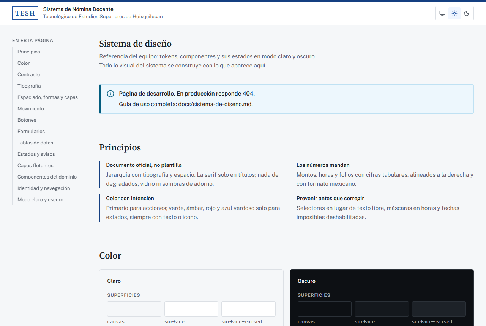
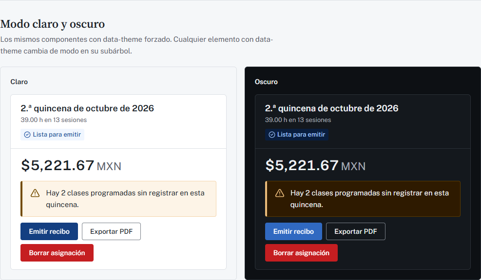
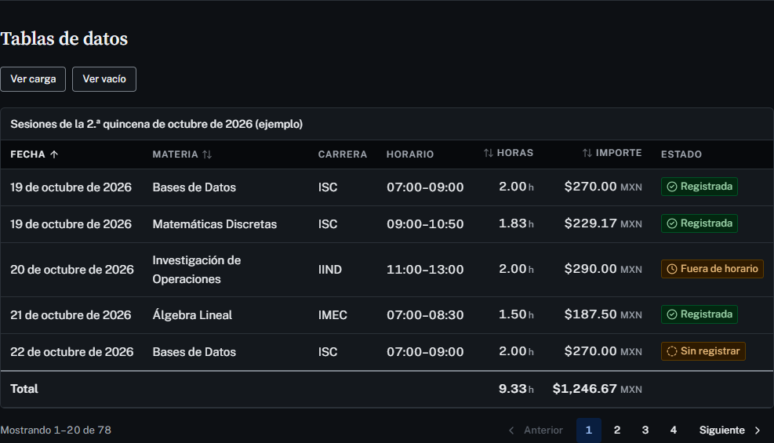
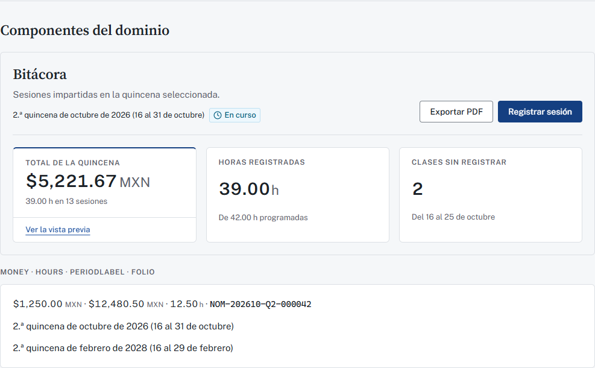
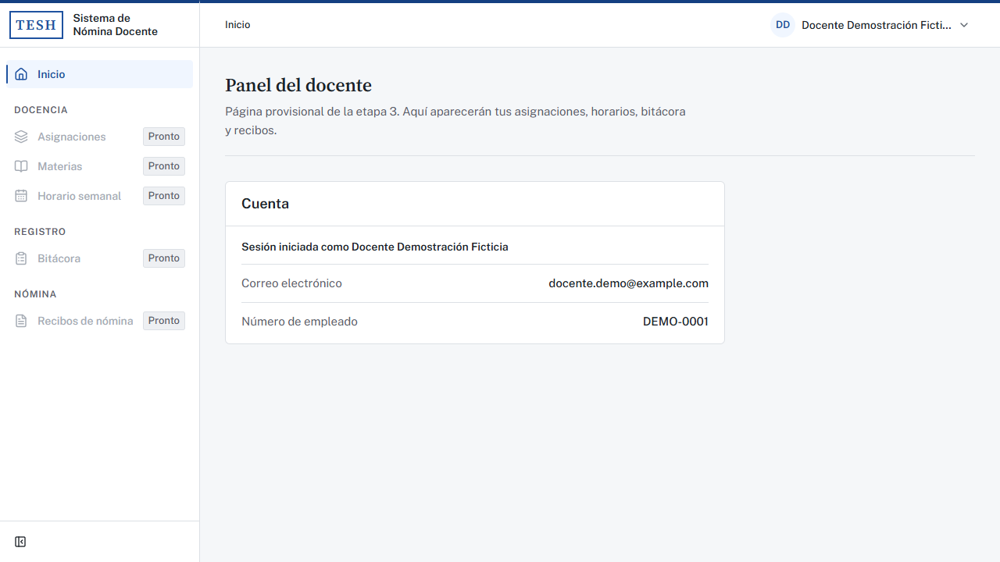
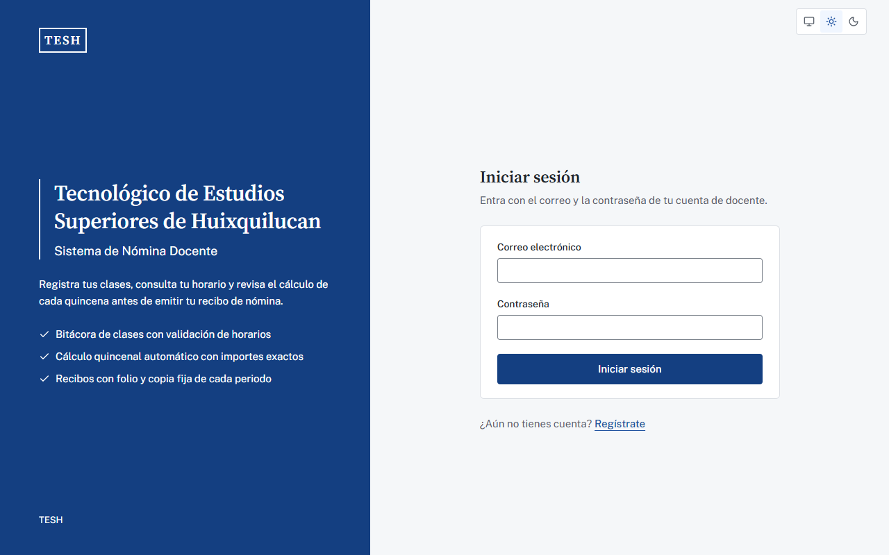
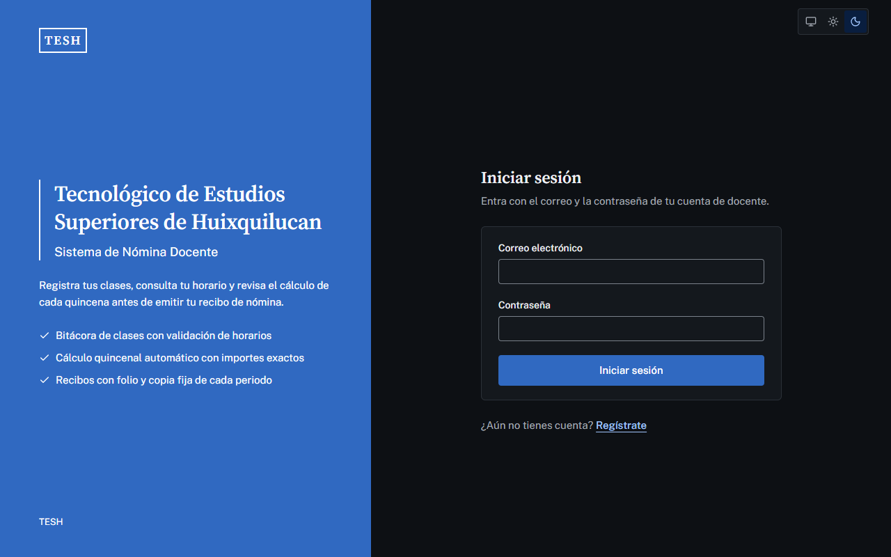
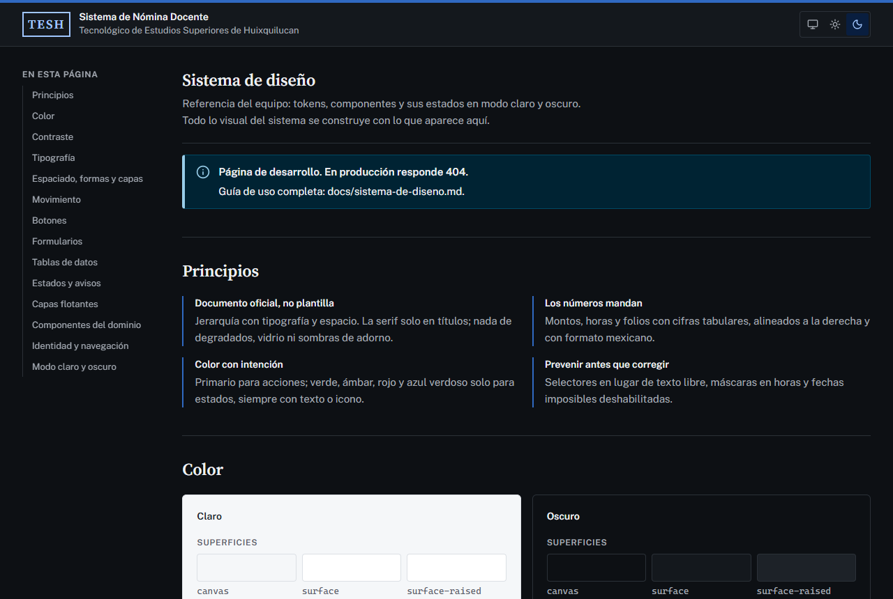
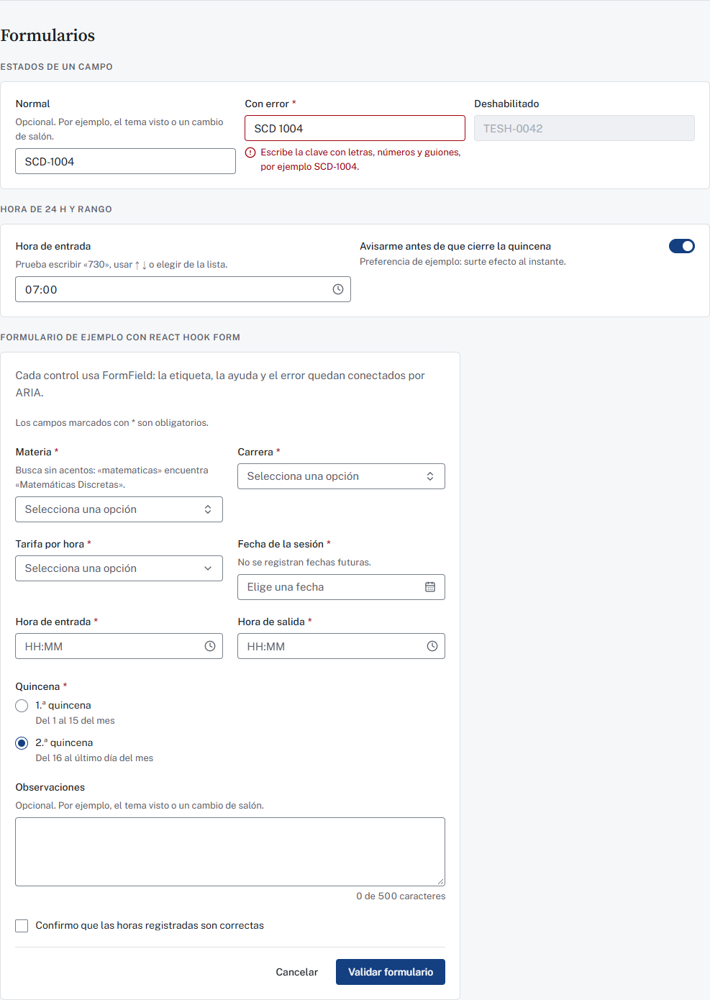
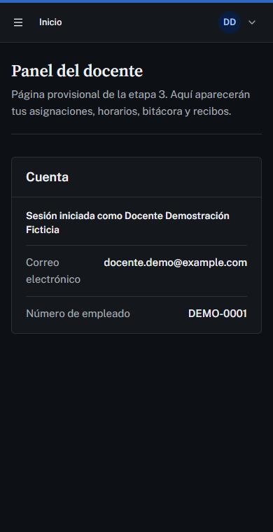

# Sistema de diseño

Referencia visual y de interacción del **Sistema de Nómina Docente** (etapa 5). Todo lo visual de las etapas 6 a 9 se construye con las piezas descritas aquí. La versión interactiva es la **guía viva** en <http://localhost:3000/sistema-diseno>, disponible solo en desarrollo.

## Índice

1. [Dirección visual](#1-dirección-visual)
2. [Paleta](#2-paleta)
3. [Tipografía](#3-tipografía)
4. [Tokens](#4-tokens)
5. [Componentes](#5-componentes)
6. [Layout](#6-layout)
7. [Accesibilidad](#7-accesibilidad)
8. [Redacción en es-MX](#8-redacción-en-es-mx)
9. [Verificaciones automáticas](#9-verificaciones-automáticas)
10. [Cómo reemplazar la marca](#10-cómo-reemplazar-la-marca)
11. [Guía viva y capturas](#11-guía-viva-y-capturas)

---

## 1. Dirección visual

**Carácter:** institucional, confiable y preciso. Es un documento oficial bien diseñado llevado a software moderno. El docente debe reconocer el sistema serio de su institución, no una plantilla.

### Principios

| Principio | En la práctica |
| --- | --- |
| **Documento oficial, no plantilla** | La jerarquía sale de la tipografía y el espacio, no de la decoración. Los títulos van en serif, como el encabezado de un oficio, y una franja de color primario corre por el borde superior como un membrete. Las tarjetas solo agrupan cuando hace falta |
| **Los números mandan** | Montos, horas y folios usan cifras tabulares (`figures`), se alinean a la derecha en las tablas y llevan formato mexicano (`$1,250.00 MXN`, `12.50 h`). La unidad (MXN, h) va más tenue que la cifra |
| **Color con intención** | El primario marca las acciones y la ubicación actual. Verde, ámbar, rojo y azul verdoso se reservan para estados y siempre van con texto o icono, nunca solos |
| **Densidad media** | El texto base mide 15 px y los controles 36 px de alto. Las tablas tienen filas cómodas, sin espacio vacío exagerado ni tarjetas gigantes |
| **Prevenir antes que corregir** | Se usan selectores en lugar de texto libre, máscara en las horas, fechas imposibles deshabilitadas y confirmación antes de lo irreversible |

### Lo que no se hace

Esta lista amplía la de CLAUDE.md §7.1:

- Degradados morado/azul, *glassmorphism* (los desenfoques están eliminados de Tailwind) y sombras difusas como adorno.
- Bordes muy redondeados: el radio máximo es de 6 px. Las etiquetas de estado tienen esquinas rectas, como un sello.
- Emojis, ilustraciones genéricas, iconos decorativos sin función, *hero sections* de marketing y textos tipo «¡Bienvenido de nuevo! 🚀».
- Tipografías trilladas (Inter, Poppins, Roboto).
- Tarjetas idénticas repetidas sin jerarquía. En el panel, un indicador es el principal (`StatCard emphasis`) y los demás lo apoyan.

## 2. Paleta

### Justificación

No hay logos oficiales todavía (`frontend/public/brand/` solo tiene su README), así que la marca es **provisional**: un **azul marino institucional** con tono OKLCH 259.

- El azul marino es el color más asociado con instituciones públicas y educativas en México. Transmite seriedad sin el peso del negro y no compite con los colores de estado.
- Los neutros son **fríos** (tono 255, croma muy bajo) para que la tinta y el papel armonicen con el primario.
- Los estados usan tonos bien separados del primario: verde 152, ámbar 75, rojo 27 e **información en azul verdoso (232)**. Así un aviso informativo no se confunde con una acción.
- Todo se define en **OKLCH**. Es un espacio perceptual: la misma claridad se ve igual de clara en cualquier tono, así que las escalas son parejas y el contraste es predecible. Cada color cabe en sRGB, y una prueba lo verifica para que el navegador no lo ajuste por su cuenta.

### Dos niveles

1. **Primitivos:** escalas completas de 11 pasos, del 50 al 950 (`--brand-*` en `styles/brand.css`; `--neutral-*` de 0 a 1000, `--green-*`, `--amber-*`, `--red-*` e `--info-*` en `styles/tokens.css`). Ningún componente los usa.
2. **Semánticos:** el papel de cada color (tabla siguiente). Son lo único que ven los componentes y lo único que cambia entre modo claro y oscuro.

| Token | Uso | Claro | Oscuro |
| --- | --- | --- | --- |
| `canvas` | Fondo de la página | neutral-50 | neutral-950 |
| `surface` | Tarjetas, tablas, campos | neutral-0 | neutral-900 |
| `surface-raised` | Menús, diálogos, popovers | neutral-0 | neutral-850 |
| `surface-sunken` | Encabezado de tabla, campo deshabilitado | neutral-100 | neutral-1000 |
| `surface-hover` | Fila o elemento bajo el puntero | neutral-50 | neutral-850 |
| `overlay` | Velo detrás de un diálogo | neutral 900, 45 % | neutral, 65 % |
| `line` | Bordes y divisiones | neutral-200 | neutral-800 |
| `line-strong` | Borde de campos (≥ 3:1) | neutral-500 | neutral-500 |
| `fg` | Texto principal | neutral-850 | neutral-100 |
| `fg-muted` | Texto secundario, ayudas | neutral-600 | neutral-400 |
| `fg-disabled` | Texto deshabilitado (exento de WCAG) | neutral-400 | neutral-600 |
| `primary` / `-hover` / `-pressed` | Botón primario y sus estados | brand-800/900/950 | brand-600/700/800 |
| `on-primary` | Texto sobre primario | neutral-0 | neutral-0 |
| `primary-soft` / `-soft-hover` | Elemento activo, selección | brand-50/100 | brand-950/900 |
| `primary-ink` | Enlaces, texto en color primario | brand-700 | brand-300 |
| `focus` | Contorno de foco | brand-600 | brand-400 |
| `success` / `warning` / `danger` / `info` | Fondo sólido de estado (botón de peligro) | green-700 · amber-400 · red-600 · info-600 | green-600 · amber-400 · red-600 · info-600 |
| `on-*` | Texto sobre el sólido | neutral-0 (ámbar: neutral-850) | neutral-0 (ámbar: neutral-900) |
| `*-soft` | Fondo de avisos y etiquetas | paso 50 | paso 950 |
| `*-ink` | Texto, icono y borde de estado (≥ 4.5:1) | paso 700 | paso 300 |
| `*-line` | Borde de avisos y etiquetas | paso 200 | paso 800 |

**Regla:** un icono o un borde que indica un estado (campo con error, aviso) usa el tono `*-ink`. Los sólidos (`danger`, `success`…) solo son fondo de botón con su `on-*`.

## 3. Tipografía

| Familia | Uso | Por qué |
| --- | --- | --- |
| **Public Sans** (variable, 100–900) | Interfaz: texto, formularios, tablas, cifras | Diseñada para servicios públicos (USWDS): neutra pero con carácter propio, legible en tamaños chicos y con cifras tabulares. Distinta de las sans de siempre |
| **Source Serif 4** (variable, tamaño óptico) | Solo `display` y títulos de página (`h1`) | Da el tono de documento oficial. El tamaño óptico ajusta el trazo según el tamaño. Nunca va en texto corrido ni en tablas |
| Monoespaciada del sistema | Folios (`NOM-202610-Q2-000042`) | Se leen y se dictan sin confundir caracteres |

Ambas se **autohospedan** con `next/font/local` a partir de los paquetes `@fontsource-variable/*` (licencia SIL OFL). El build no descarga nada de internet, el navegador no consulta servicios de terceros y solo se carga el subconjunto latino, que incluye á, ñ, ¿, ¡, ª y –. La configuración está en `src/config/fonts.ts`.

### Escala semántica

Tailwind ya no tiene `text-sm`, `text-lg` y similares: solo existen estos nombres.

| Clase | Tamaño / interlineado | Peso | Uso |
| --- | --- | --- | --- |
| `text-display` | 32 / 40 px | 600 | Nombre de la institución en el acceso |
| `text-title` | 24 / 32 px | 600 | Título de página (`h1`, con `font-serif`) |
| `text-subtitle` | 18 / 24 px | 600 | Título de sección, de tarjeta o de diálogo |
| `text-body` | 15 / 24 px | 400 | Texto base, celdas de tabla |
| `text-label` | 14 / 20 px | 500 | Etiquetas de campo, botones, navegación |
| `text-small` | 13 / 20 px | 400 | Ayudas, errores de campo, metadatos |
| `text-overline` | 12 / 16 px, +0.06 em | 600 | Encabezados de tabla y de grupo (con `uppercase`) |
| `text-figure` | 28 / 36 px | 600 | Cifra de un indicador (`StatCard`) |
| `text-control` | 16 px | — | Campos en celular (con menos, iOS hace zoom) |
| `text-unit` | 0.8 em | — | Unidad junto a una cifra (MXN, h) |

**Cifras:** cualquier número que se compare en columna lleva `figures` (`tabular-nums`). `Money`, `Hours`, las celdas `align: "end"` de DataTable y `StatCard` ya lo aplican.

## 4. Tokens

Fuente única: `frontend/src/styles/`.

| Archivo | Contenido |
| --- | --- |
| `brand.css` | Escala de color de marca: el único color institucional |
| `tokens.css` | Primitivos, semánticos (claro y oscuro), tipografía, espaciado, formas, sombras, capas y movimiento: solo valores |
| `globals.css` | Mapeo a Tailwind (`@theme inline`), eliminación de las escalas por defecto, foco global, utilidad `figures` y puntos de quiebre |
| `token-catalog.ts` | Nombres de los tokens semánticos y pares de contraste (lo usan la prueba y la guía) |
| `motion.ts` | Duraciones y curvas para Framer Motion; una prueba verifica que coincidan con `tokens.css` |

### Espaciado y medidas

La escala base es la de Tailwind (múltiplos de 4 px: `p-4` = 16 px). Para composición hay tokens con nombre:

| Token | Valor | Uso |
| --- | --- | --- |
| `--page-gutter` | 16 px → 24 px (md) → 32 px (xl) | Margen lateral de la página: `px-(--page-gutter)` |
| `--page-block` | 24 px → 32 px (md) | Margen vertical del contenido |
| `--section-gap` | 32 px | Separación entre secciones; bajo el `PageHeader` |
| `--field-gap` | 20 px | Separación entre campos: `gap-(--field-gap)` |
| `--control-height-sm/md/lg` | 32 / 36 / 44 px | Alturas comunes de botones, campos y selectores |
| `--width-content` · `-form` · `-auth` · `-dialog` · `-prose` | 80 · 40 · 27 · 32 rem · 65 ch | `max-w-content`, `max-w-form`, `max-w-auth`, `max-w-dialog`, `max-w-prose` |
| `--sidebar-width` / `-collapsed` · `--topbar-height` | 16 rem / 3.75 rem · 3.5 rem | Estructura del panel |

### Formas, sombras y capas

| Token | Valor | Uso |
| --- | --- | --- |
| `rounded-xs` · `-sm` · `-md` · `-lg` | 2 · 3 · 4 · 6 px | Casillas · etiquetas · controles · tarjetas y diálogos. `rounded-full` solo para avatares, radios e interruptores |
| `shadow-xs` | línea de 1 px | Separación mínima |
| `shadow-sm` | corta y tenue | Menús, popovers, selectores |
| `shadow-md` | más profunda | Diálogos y notificaciones |
| `--layer-*` | sticky 10 · sidebar 20 · overlay 40 · modal 50 · popover 60 · toast 70 · tooltip 80 · skip-link 90 | `z-(--layer-modal)`; nunca un `z-50` suelto |

Las sombras se tiñen con la tinta del sistema (azul muy oscuro), nunca con negro puro, y en modo oscuro son más densas. Solo separan capas que flotan.

### Puntos de quiebre

`sm` 640 px · `md` 768 px · `lg` 1024 px · `xl` 1280 px. Viven en `globals.css` porque las *media queries* no aceptan variables. El diseño se piensa para escritorio, pero las clases van de menor a mayor. La barra lateral aparece desde `lg`; DataTable cambia a tarjetas por debajo de `md`.

### Movimiento (preparado para la etapa 9)

| Token | Valor | Uso previsto |
| --- | --- | --- |
| `--duration-fast` | 120 ms | Hover, cambios de color |
| `--duration-base` | 180 ms | Contraer la barra, abrir menús |
| `--duration-slow` | 280 ms | Paneles deslizables |
| `--duration-emphasis` | 400 ms | Transiciones de página |
| `--easing-standard` · `-enter` · `-exit` | curvas de Bézier | Movimiento general · entradas · salidas |

Con `prefers-reduced-motion: reduce`, las cuatro duraciones valen 0 ms y una regla global anula animaciones y transiciones. En Framer Motion se usan `DURATIONS` y `EASINGS` de `styles/motion.ts` y `useReducedMotion()`.

## 5. Componentes

Los componentes base están en `src/components/ui/`, los del dominio en `src/components/domain/` y los de estructura en `src/components/layout/`. Todos usan solo tokens semánticos, tienen foco visible y funcionan con teclado.

### Acciones

| Componente | Cuándo | Cuándo no |
| --- | --- | --- |
| `Button` `primary` | La acción principal de la vista (una sola) | Varias acciones del mismo peso: usa `outline` |
| `secondary` | Acción frecuente pero no principal (ver horario) | Junto a otra `secondary`: pierden jerarquía |
| `outline` | Acciones secundarias, exportar, cancelar en un diálogo | — |
| `ghost` | Acciones terciarias, iconos en barras, paginación | Como única acción visible |
| `danger` | Borrar o desactivar, **siempre** detrás de `ConfirmDialog` | Para llamar la atención |
| `link` | Navegación dentro de un texto o una tarjeta | Acciones que cambian datos |

Tamaños: `sm`, `md` y `lg`; `icon` e `icon-sm` (con `aria-label` obligatorio). Con `loading`, el texto se oculta sin cambiar el ancho, aparece un indicador, el botón se deshabilita y los lectores de pantalla oyen `loadingLabel`. Para un enlace con forma de botón se usa `asChild`.

### Captura

| Componente | Cuándo | Cuándo no |
| --- | --- | --- |
| `Field` | Envoltorio de todo campo: etiqueta, `*` si es obligatorio (`required`) o «(opcional)» en formularios con obligatorios (`optional`), ayuda, control y error, conectados por ARIA (`aria-describedby`, `aria-invalid`, `required`) automáticamente | — |
| `FormField` | Igual, conectado a React Hook Form con `Controller` para controles no nativos | Con `<Input>` nativo basta `register()` dentro de `Field` |
| `Fieldset` | Grupo de radios o casillas (`fieldset` + `legend`) | Un solo control |
| `FormRequiredNote` | Al inicio de un formulario de captura con obligatorios | Formularios de 2 campos evidentes (iniciar sesión) |
| `Input` | Texto corto que no existe en el sistema (clave, nombre) | Datos que ya existen: usa un selector |
| `PasswordInput` | Toda contraseña: botón para mostrarla u ocultarla (`aria-pressed`) y aviso de Bloq Mayús anunciado y enlazado al campo | — |
| `Textarea` (`showCount`) | Observaciones con límite (500) | — |
| `Select` | Lista corta y conocida (tarifas, quincena, estado) | Más de ~8 opciones o cuando se busca por nombre |
| `Combobox` | Listas largas que se reconocen por nombre (materias, carreras). La búsqueda ignora acentos, mayúsculas y el orden de las palabras; admite grupos y descripción | Texto libre: nunca acepta valores fuera de la lista |
| `Checkbox` | Sí/no dentro de un formulario que se envía; confirmar algo | Preferencias inmediatas: usa `Switch` |
| `RadioGroup` | 2 a 5 opciones excluyentes que conviene ver juntas | Muchas opciones: usa `Select` |
| `Switch` | Preferencias que surten efecto al instante | Formularios con botón Guardar |
| `DatePicker` | Fechas ISO; semana desde el lunes; `min`, `max` y `disableFuture` (hoy en la Ciudad de México). Fuera de rango, los días aparecen tachados y no se pueden elegir | Rangos de varias fechas (otro componente cuando haga falta) |
| `TimeInput` | Hora de 24 h. Máscara al escribir («730» → 07:30, «25» → 02:5), ajuste al intervalo `step` al salir, ↑ ↓ por intervalos y lista desplegable (`listStep`). Solo entrega una `HH:MM` válida o `null` | — |
| `TimeRangeInput` | Entrada y salida de una clase: la lista de la salida empieza después de la entrada, muestra la duración en vivo y avisa si la salida no es posterior o la duración sale de los límites de `GET /catalogs/business-rules` | — |

**Reglas de formularios:** el error aparece al salir del campo (`mode: "onTouched"`) y dice qué pasó y cómo corregirlo. La ayuda permanente va entre la etiqueta y el control. El botón de enviar muestra `loading` en lugar de cambiar su texto. Un error que no corresponde a un campo va en un `Alert tone="danger" announce` al inicio del formulario.

### Datos

| Componente | Cuándo |
| --- | --- |
| `DataTable` | Listados (bitácora, recibos, asignaciones). Columnas con `align: "end"` para cifras, `sortValue` para ordenar (`aria-sort`, orden español con acentos), `loading` con *skeleton*, `empty` con un `EmptyState`, `footer` para totales y `pagination` con el sobre del backend (`page`, `page_size`, `total`, `total_pages`). Por debajo de `md`, cada fila es una tarjeta: la columna `primary` es el título y `hideOnMobile` oculta las secundarias |
| `Table*` | Tablas simples sin orden ni paginación (desglose de un recibo) |
| `Pagination` | Ya integrada en DataTable; sola si la lista no es tabla |
| `StatCard` | Indicadores del panel (3 o 4, uno con `emphasis`) |
| `EmptyState` | Vacíos: qué falta, por qué y la acción que lo resuelve. El icono nombra lo que falta |

### Avisos y estado

| Componente | Cuándo | Cuándo no |
| --- | --- | --- |
| `Badge` (`tone`) | Etiqueta breve | Como botón |
| `StatusBadge` | Estados del dominio con el mismo color, icono y texto en todo el sistema: sesión registrada, sin registrar, bloqueada o fuera de horario; quincena próxima, en curso, lista para emitir o emitida; activa, inactiva, revisar. Un estado nuevo se agrega en `status-badge.tsx` | — |
| `Alert` | Aviso dentro de la página (advertencias de la vista previa, empalmes). `announce` solo si aparece por algo que hizo la persona | Confirmaciones pasajeras: usa toast |
| `toast` (`success`, `error`, `warning`, `info`) | Confirmar una acción terminada («Sesión registrada») | Información que se necesita conservar, o el único aviso de un error de formulario |
| `Skeleton` | Carga con la forma del contenido | Cargas de menos de ~300 ms |
| `Spinner` | Dentro de botones y acciones en curso | Para cargar una página |

### Capas flotantes

| Componente | Cuándo |
| --- | --- |
| `Dialog` | Tarea corta sin página propia (editar una sesión, agregar un horario) |
| `ConfirmDialog` | **Toda** acción destructiva o irreversible: borrar (`tone="danger"`), emitir un recibo (`tone="primary"`). Título con la pregunta concreta, `consequences` con lo que se pierde, verbo en el botón y el foco inicial en «Cancelar» |
| `Sheet` | Navegación en celular |
| `Popover` | Base del calendario, de la lista de horas y del combobox |
| `DropdownMenu` | Menú de la cuenta, «más acciones» de una fila (`tone="danger"` en borrar) |
| `Tooltip` | Nombrar un botón de solo icono o la barra contraída. Nunca guarda información indispensable (no aparece en pantallas táctiles) |
| `Tabs` | Vistas alternas del mismo contenido (lista o semana), no pasos de un proceso |

### Dominio

| Componente | Muestra |
| --- | --- |
| `Money` | `$1,250.00 MXN` a partir de la cadena decimal de la API, sin convertirla a número |
| `Hours` | `12.50 h` |
| `PeriodLabel` | `2.ª quincena de octubre de 2026`; con `withRange`, agrega `(16 al 31 de octubre)` |
| `Folio` | Folio en monoespaciada |
| `StatusBadge` | Ver «Avisos y estado» |

### Iconos

Se usa lucide-react con trazo de 1.75 (`--icon-stroke`, aplicado a `svg.lucide` en `globals.css`). El tamaño es de 16 px (`size-4`) junto al texto y de 18 a 20 px en la navegación y los avisos. Todo icono tiene función: acompaña a un texto (y entonces lleva `aria-hidden="true"`) o es el único contenido de un botón con `aria-label`. Nunca hay iconos de adorno.

## 6. Layout

| Componente | Descripción |
| --- | --- |
| `AppShell` | Estructura del panel. Barra lateral con grupos (Docencia, Registro, Nómina), elemento activo resaltado (`aria-current="page"`) y contraíble en escritorio con preferencia recordada y aplicada antes de pintar. En celular es un panel deslizable. La barra superior tiene migas de pan y el menú de la cuenta (perfil, cambiar contraseña, apariencia y cerrar sesión). Lo usa `features/auth/components/authenticated-shell.tsx` con los datos de la sesión |
| `AuthLayout` | Iniciar sesión y registro. En escritorio, una franja en color primario con el nombre de la institución en serif; en celular, el logotipo arriba del formulario |
| `SiteHeader` | Páginas públicas (404, error inesperado, guía viva) |
| `StatusScreen` | Pantalla completa de la página no encontrada y del error inesperado: código, título en serif, qué pasó y cómo seguir |
| `PageHeader` | Título (único `h1`), descripción, contexto (`meta`), acciones y migas propias cuando la barra superior no las conoce |
| `Logo` | Logo oficial de `config/brand.ts` o, mientras no exista, el logotipo tipográfico: siglas en serif dentro de un marco, como un sello. Variantes `full`, `compact` y `mark`; tono `inverse` sobre primario |
| `SkipLink` | «Saltar al contenido»: primer elemento enfocable de cada página. Todos los layouts ponen `id="contenido"` en su `main` |
| `ThemeSwitcher` · `ThemeMenuOptions` | Tema: como el sistema, claro u oscuro |

La navegación está definida en `src/constants/navigation.ts` y **solo contiene secciones que existen**: nunca se muestran elementos deshabilitados ni «Pronto». Al construir una pantalla se agrega su elemento ahí y aparece sola en la barra lateral y en las migas; `isAvailableRoute()` permite enlazarla desde otras pantallas solo cuando ya existe.

### Tema claro y oscuro

- El script de `src/lib/theme/preferences-script.ts` corre en `<head>` antes de pintar. Lee la preferencia guardada (`localStorage`, con `try/catch`) y fija `data-theme`, `data-theme-preference` y `data-sidebar` en `<html>`, así que no hay parpadeo. Si el almacenamiento falla, se usa la preferencia del sistema operativo.
- `src/lib/theme/preferences-store.ts` expone `useThemePreference`, `useResolvedTheme`, `useSidebarState` y sus *setters* con `useSyncExternalStore`. Sigue el cambio de tema del sistema operativo y el de otras pestañas.
- Cualquier elemento con `data-theme="light|dark"` fuerza un modo en su subárbol. Lo usa la guía para mostrar ambos modos lado a lado.
- Los componentes casi nunca necesitan la variante `dark:`: los tokens semánticos ya cambian solos.

## 7. Accesibilidad

Objetivo: **WCAG 2.2 AA**.

- **Contraste:** cada par de texto y fondo cumple 4.5:1, y los bordes de campo, el foco y los iconos con significado cumplen 3:1, en ambos modos. La prueba automatizada lo exige (§9).
- **Foco visible único:** un contorno de 2 px en color `focus` con separación de 2 px, en `:focus-visible` global. Se usa `outline`, no sombra, para que sobreviva al modo de alto contraste de Windows.
- **Teclado:** todo funciona sin ratón. Lo verifiqué con un navegador sin interfaz:
  - el enlace para saltar al contenido es el primer elemento enfocable;
  - el combobox se abre con Enter, se busca escribiendo y se elige con Enter;
  - la hora cambia con ↑ ↓;
  - el calendario recibe el foco al abrirse;
  - los diálogos atrapan el foco, lo devuelven al cerrarse, empiezan en «Cancelar» y se cierran con Escape;
  - el panel de navegación del celular se abre y cierra con teclado.
- **Formularios:** toda etiqueta está asociada a su control. Ayuda y error van en `aria-describedby`, y `aria-invalid` y `required` se ponen solos. Los obligatorios llevan `*` visual y «(obligatorio)» para lectores de pantalla. Los errores se anuncian (`role="alert"`).
- **Sin depender del color:** los estados llevan texto e icono, y los requisitos de la contraseña tienen un icono por estado y su texto para lectores de pantalla.
- **Regiones vivas:** `aria-live="polite"` en la duración de la clase, el resumen de la paginación y las cargas (`aria-busy`).
- **Movimiento:** se respeta `prefers-reduced-motion` (§4).
- **Celular:** los campos usan 16 px y no hay desbordamiento horizontal. Lo verifiqué a 390 px en iniciar sesión, registro, panel y guía viva.
- **Idioma:** `<html lang="es-MX">`, y el calendario usa la configuración regional `es` con la semana empezando en lunes.

## 8. Redacción en es-MX

Todos los textos viven en `src/constants/`: `texts.ts`, `error-messages.ts`, `warning-messages.ts`, `navigation.ts` y `design-guide.ts`.

| Regla | Sí | No |
| --- | --- | --- |
| Tuteo institucional, claro y corto | «Registra tus clases de hoy» | «Usted podrá proceder a registrar…» |
| El error dice qué pasó y cómo corregirlo | «El horario se empalma con Bases de Datos (lunes 10:00–12:00). Elige otra hora de entrada o de salida.» | «Error de validación» |
| Botones con verbo y objeto | «Emitir recibo», «Borrar asignación» | «Aceptar», «OK», «Sí» |
| La confirmación pregunta lo concreto | «¿Borrar la asignación Bases de Datos – ISC?» | «¿Está seguro?» |
| El vacío explica y propone | «Aún no registras sesiones en esta quincena. Registra la primera…» | «No hay datos» |
| Formatos del sistema (CLAUDE.md §7.4) | `$1,250.00 MXN`, `15 de octubre de 2026`, `07:00`, `12.50 h`, «2.ª quincena» | `$1250`, `10/15/26`, `7:00 a.m.` |
| Mayúsculas solo al inicio y en nombres propios | «Recibos de nómina» | «Recibos De Nómina» |
| Sin emojis ni signos de exclamación de entusiasmo | «Sesión registrada» | «¡Listo! 🎉» |
| Raya (–) en rangos de horas y guion en claves | `07:00–09:00`, `SCD-1004` | `07:00 - 09:00` |

## 9. Verificaciones automáticas

`npm run check` (en `frontend/`) ejecuta lint, tipos, formato y **`npm test`** (Vitest):

| Prueba | Qué exige |
| --- | --- |
| `src/styles/tokens.test.ts` | Cada par de `CONTRAST_PAIRS` cumple WCAG AA en claro y en oscuro; todos los tokens semánticos existen en ambos modos; todo primitivo cabe en sRGB; los semánticos solo apuntan a primitivos; `globals.css` expone cada token y elimina las escalas por defecto |
| `src/styles/no-literal-values.test.ts` | Fuera de `tokens.css`, `brand.css` y el lector de OKLCH no hay colores literales (`#hex`, `rgb()`, `oklch()`…), valores arbitrarios de Tailwind con medidas o colores (`w-[37px]`, `bg-[#…]`), colores de la paleta de Tailwind (`bg-blue-500`) ni tamaños, sombras, radios o desenfoques eliminados (`text-sm`, `shadow-xl`, `rounded-2xl`, `backdrop-blur`). Para una medida nueva se crea un token y se usa con `w-(--token)` |
| `src/styles/motion.test.ts` | `motion.ts` coincide con `tokens.css` y las duraciones se anulan con movimiento reducido |
| `src/lib/*.test.ts` | Máscara y lectura de horas, búsqueda sin acentos, orden en español, paginación, fechas en la zona de la Ciudad de México y resolución de clases CSS (`cn`) |

## 10. Cómo reemplazar la marca

Cuando el TESH entregue los logos oficiales:

1. **Archivos:** cópialos a `frontend/public/brand/` con los nombres de su README (`logo.svg`, `logo-monochrome.svg`, `isotype.svg`, `favicon.svg`).
2. **Logo:** en `frontend/src/config/brand.ts` declara `logo: { src: BRAND_ASSETS.logo, width, height }` y `logoOnDark` (normalmente la versión monocromática). El componente `Logo` deja de mostrar el logotipo tipográfico en todo el sistema.
3. **Ícono:** reemplaza `frontend/src/app/icon.svg` por el favicon oficial (Next.js lo publica solo).
4. **Color:** reemplaza los 11 pasos de `frontend/src/styles/brand.css` por la escala del color institucional en OKLCH, del 50 (más claro) al 950. Para obtenerla, toma el color principal del logo, conviértelo a OKLCH (por ejemplo, con <https://oklch.com>), conserva su tono y su croma, y reparte la claridad como en la escala actual (0.97, 0.94, 0.89, 0.82, 0.73, 0.63, 0.53, 0.45, 0.38, 0.31, 0.24), bajando el croma en los extremos.
5. **Verifica:** `npm test`. Si un par no cumple AA, la prueba dice cuál y con qué contraste; en ese caso ajusta qué paso usa el token semántico en `tokens.css` (por ejemplo, `--primary: var(--brand-900)`), no el componente. Revisa la guía viva en ambos modos.
6. **Nombre:** el nombre y las siglas vienen de `NEXT_PUBLIC_INSTITUTION_NAME` y `NEXT_PUBLIC_INSTITUTION_SHORT_NAME` (`frontend/.env.local`).

No se toca ningún componente.

## 11. Guía viva y capturas

- **URL:** <http://localhost:3000/sistema-diseno> con `bash scripts/dev.sh`.
- **Disponibilidad:** la controla `DESIGN_GUIDE_ENABLED` (`frontend/.env.local`). En un build de producción (`next build && next start`) responde **404** aunque la variable valga `true`, y no se indexa (`robots: noindex`).
- **Contenido:**
  - principios;
  - color, con ambos modos lado a lado y el contraste de cada par calculado en vivo con los valores del navegador;
  - tipografía y cifras tabulares frente a proporcionales;
  - espaciado, alturas de control, radios, sombras, capas y movimiento;
  - botones;
  - formularios: estados y un formulario con React Hook Form y Zod;
  - tabla de datos con orden, carga, vacío y paginación;
  - estados, avisos y notificaciones;
  - capas flotantes;
  - componentes del dominio;
  - identidad y comparación de modos.
- **Ejemplos:** los valores de la guía imitan datos reales del sistema y están en `src/constants/design-guide.ts`. Nunca se muestran fuera de esta página.

| Modo claro | Modo oscuro |
| --- | --- |
|  |  |
|  |  |

Las capturas se tomaron con Microsoft Edge sin interfaz (`playwright-core` instalado fuera del repositorio), a 1280 px de ancho, y a 390 px para la del celular.
